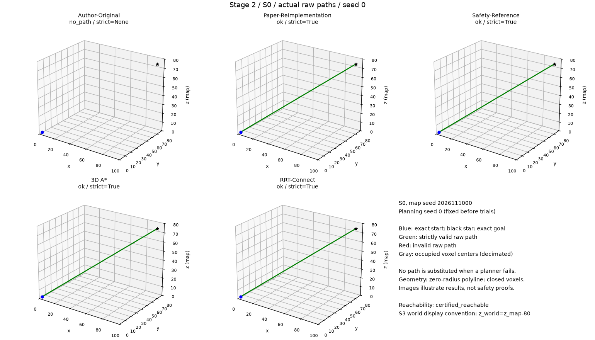
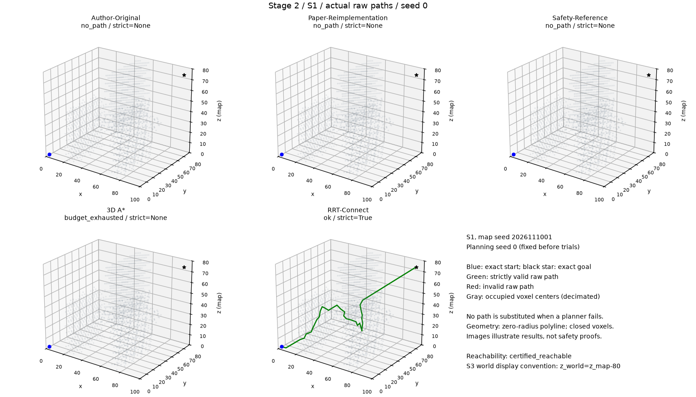
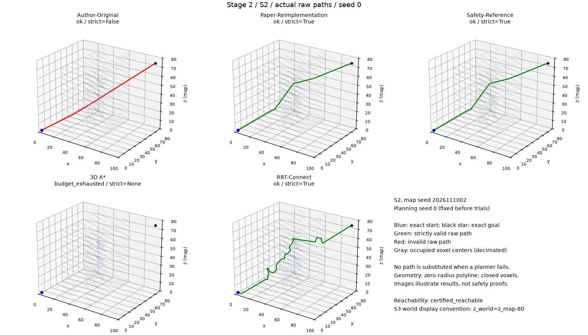
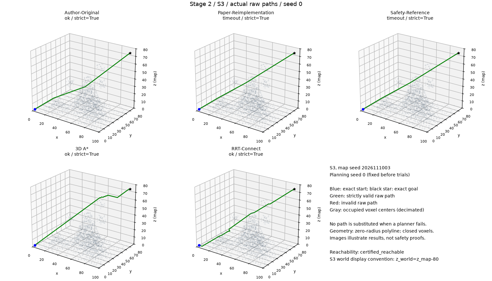
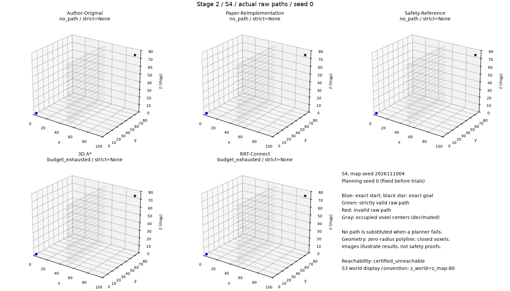

# G-Sunlight 第二阶段科研复现报告

日期：2026-11-10（Asia/Shanghai）。本阶段完成的是披露假设的论文结构重建、严格安全参考、固定合成地图和五方法对比，不是论文所有图表或真实AUV实验的完整复现。

## A. 保存阶段一与研究边界

以 `repro/gsunlight-stage1` 为基础建立 `repro/gsunlight-stage2`。阶段一报告、CSV和本地原始记录保留；作者PDF、ZIP、Python源码和原始map.vti未修改、未重新发布。新PR目标为阶段一分支，不修改或合并main。没有运行额外SHA256、MD5或其他文件哈希，没有校验清单，没有GPU训练、洋流、MPC、Attention、强化学习或动态障碍。

重新核对14页论文、算法1—5、公式(1)—(6)。[三版本差异表](STAGE2_PAPER_CODE_DIFF_CN.md)逐项对应论文与原件；[假设文档](STAGE2_ASSUMPTIONS_CN.md)公开ChooseSun、计数、角边界、碰撞策略和初始化等解释；[版本和运行指南](STAGE2_VERSION_GUIDE_CN.md)给出方法入口与配置。未定义事项没有被冒充原文明确结论。

## B. 环境、实现与安全范围

本机Windows 11，Ryzen 5 9600X、32GB、RTX5060 8GB（未作训练或GPU规划）。Python3.11.15；NumPy2.4.6、PyVista0.49.2、VTK9.7.2、OpenCV5.0.0.93、Pillow13.0.0、Matplotlib3.11.2。实验串行，地图由配置在内存生成；父验证进程与各持久worker独立加载自己的地图，worker内逐seed复用，不复制作者地图。

| 方法 | 版本与关键行为 |
| --- | --- |
| Author-Original | `author-zip-2026-stage2-observation-v1`；运行本机原件，只跳过显示及增加可恢复纯观察计数。原始选点、随机调用、容量管理、碰撞和原生五轮后处理保留。新增包装后seed0的路径、参数、节点和计数与阶段一逐字段一致 |
| Paper-Reimplementation | `stage2-paper-v1`；自编算法1—5，先当前太阳直连、清理当前网格成员、保留历史g、非最佳插索引1、超容删末点、不首路径早停、最终选路径集最短。角上限及径向步长采用论文解释 |
| Safety-Reference | `stage2-safety-v1`；独立自编参考，与Paper共享自编控制核心和纯几何工具，显式增加父边、完整目标链及最终路径防护；不依赖作者hook，不调用其他规划器兜底 |
| 3D A* | `stage2-astar-v1`；26邻居中心图，真实端点作虚拟连接，局部supercover禁止对角穿角；以独立Dijkstra核对小图代价 |
| RRT-Connect | `stage2-rrt-connect-v1`；双树、线性NumPy最近邻、步长5、目标偏置.05；每次扩展、连接、树交换重建和最终路径均严格检查 |

沿用阶段一连续闭体素检测器：面、棱、角接触算碰撞；地图外无效，允许地图几何外边界但检查相邻障碍。所有返回路径再由实验层验证连续线段及原始起终点。独立方法均检查端点；作者输入的有效性先由场景生成器核验，不给原版悄悄插入安全逻辑。判断只针对零半径几何折线，不证明真实尺寸AUV、动力学或控制可执行性。

Paper/Safety主结果为原始折线。共同shortcut只在原始路径已严格有效时运行，再完整复检；不把无效路径后处理成成功来覆盖主结果。作者自带后处理另列native字段，不能用于主要长度排名。两种独立G-Sunlight在当前参数下可能得到相同路径；共享逻辑及未触发防护会如实披露，不人为制造方法差异。

## C. 五张固定合成地图

配置为 [stage2_maps.json](../configs/stage2_maps.json)。统一100×80×80个cell、origin0、spacing1、起点(2,2,2)、目标(95,75,75)，兼容作者原件的固定坐标。所有地图均为提前声明的确定性配方，map_seed是配方标识，不是随机障碍输入；5个规划seed不等于5张随机地图。

| 场景 | 配方与可达性 |
| --- | --- |
| S0 | 全空；严格直连见证 |
| S1 | 错位长方体及球障碍；预先声明的绕行见证 |
| S2 | 两堵厚2体素墙、宽6体素错位窗口及U形凹障碍；穿窗绕行见证 |
| S3 | 高斯峰谷海床及球障碍；高处绕行见证；地图正z，显示约定z_world=z_map−80 |
| S4 | x轴48—52完整封闭墙，覆盖全部y/z；验证封闭墙与端点分处两侧的解析不可达证书 |

S0—S3见证均经严格检测，但从未传给规划器作参考路径。S4不可达来自几何证书，不来自超时或搜索失败。S3不是论文100m×100m/45球障碍场景，单位只称地图坐标单位。不因实验失败移动障碍、清理通道、换地图种子或调参。

## D. 真实运行范围与公平预算

先完成本地单元检查和作者原图seed0回归，再完成S0、S1的单次五方法预检；S1逐级扩到5seed(25条)，确认记录正确、资源可控后，运行S0/S2/S3/S4各5seed(100条)。两个原始part保留不动，合并为**125个唯一场景/方法/seed试验**，不重跑S1以挑选数字。另有3方法S0早期预检，未混入正式表。命令见[实际运行记录](STAGE2_COMMANDS_CN.md)。

配置为 [stage2_experiment.json](../configs/stage2_experiment.json)：独立搜索预算30s，共同外部保护32s，启动上限30s单列；独立节点上限100000，外部迭代上限10000。Paper/Safety另有论文口径n_max100、容量1；A*不使用10000迭代上限，100000是发现的cell状态数；RRT记录自己的节点/迭代限制。作者原生max_iter100保留，不声称其迭代含义相同。

启动和生成地图不占首seed搜索额度。没有路径的strict_valid、长度和碰撞数留空；实际生成无效路径才写False。硬超时未捕获的返回值标未知，不推定reported_success=False或填节点0。已有有效候选但预算中止时保留坐标、reported_success和timeout/budget状态。`budget_valid_success`要求status=ok且返回时间在30s内，是严格于“拥有有效路径”的完整正常完成口径。

作者原生search计时止于原后处理前，独立入口计时包括自身初始化/防护，范围不完全相同。CSV另有planner_call和request墙钟、启动、终验及共同后处理时间；作者完整调用还含独享的原生后处理，因此本报告不据单个时间列宣布统一速度优胜。时间仅为本机描述，不与论文硬件结果直接比较。A*五个seed是重复计时，不是五个独立随机事件。

## E. 对比结果

严格有效原始路径数（不等同于正常预算完成；S4单列负例）：

| 场景 | Author-Original | Paper-Reimplementation | Safety-Reference | 3D A* | RRT-Connect |
| --- | --- | --- | --- | --- | --- |
| S0 | 0/5 | 5/5 | 5/5 | 5/5 | 5/5 |
| S1 | 0/5 | 0/5 | 0/5 | 0/5 | 5/5 |
| S2 | 0/5 | 5/5 | 5/5 | 0/5 | 5/5 |
| S3 | 5/5 | 5/5 | 5/5 | 5/5 | 5/5 |
| S4 | 0/5 | 0/5 | 0/5 | 0/5 | 0/5 |

正常且预算内的严格有效完成数：

| 场景 | Author-Original | Paper-Reimplementation | Safety-Reference | 3D A* | RRT-Connect |
| --- | --- | --- | --- | --- | --- |
| S0 | 0/5 | 5/5 | 5/5 | 5/5 | 5/5 |
| S1 | 0/5 | 0/5 | 0/5 | 0/5 | 5/5 |
| S2 | 0/5 | 5/5 | 5/5 | 0/5 | 5/5 |
| S3 | 5/5 | 0/5 | 0/5 | 5/5 | 5/5 |
| S4 | 0/5 | 0/5 | 0/5 | 0/5 | 0/5 |

| 方法 | ok | no_path | 节点/迭代预算 | timeout | error | crash |
| --- | --- | --- | --- | --- | --- | --- |
| Author-Original | 10 | 15 | 0 | 0 | 0 | 0 |
| Paper-Reimplementation | 10 | 10 | 0 | 5 | 0 | 0 |
| Safety-Reference | 10 | 10 | 0 | 5 | 0 | 0 |
| 3D A* | 10 | 0 | 15 | 0 | 0 | 0 |
| RRT-Connect | 20 | 0 | 5 | 0 | 0 | 0 |

正式125条中，保留严格有效路径65条、实际无效路径5条、未捕获路径证据55条；异常(error/crash)0条。native后处理无效10条，共同后处理无效0条。路径无效、没有路径和地图不可达分别解释，不能混成一个“碰撞失败率”。

关键机制：S0原版没有起点直连分支而候选耗尽；S1存在严格可达见证，独立G-Sunlight仍可能因候选集管理与有限采样而耗尽，A*达到节点上限不能证明无解；S2原版的报告成功被独立检测拒绝，独立方法所得路径则按严格验收计数；S3部分G-Sunlight候选在截止时被保留，状态不可改写为正常完成；S4分析证书与方法停止状态分开。

完整记录：[runs.csv](../results/stage2/runs.csv)、[summary.csv](../results/stage2/summary.csv)、[failure_mechanisms.csv](../results/stage2/failure_mechanisms.csv)、[node_counts.csv](../results/stage2/node_counts.csv)。汇总长度只对strict=True路径求均值，可能包括预算中止时保留的候选，不能称为“正常预算成功长度均值”。不对无效路径或空值填0。

## F. 候选管理与失败机制

以下为各场景5次合计的观察事件，不是单因素因果消融：

| 场景 | 方法 | 原始候选 | 入图候选 | 碰撞拒绝 | 容量淘汰 | 实际展开 |
| --- | --- | --- | --- | --- | --- | --- |
| S1 | Paper-Reimplementation | 1713 | 1713 | 0 | 1421 | 297 |
| S1 | Safety-Reference | 1713 | 1713 | 0 | 1421 | 297 |
| S2 | Paper-Reimplementation | 783 | 783 | 0 | 559 | 229 |
| S2 | Safety-Reference | 783 | 783 | 0 | 559 | 229 |
| S3 | Paper-Reimplementation | 12380 | 12380 | 0 | 11200 | 610 |
| S3 | Safety-Reference | 11859 | 11859 | 0 | 10706 | 582 |
| S4 | Paper-Reimplementation | 0 | 0 | 0 | 0 | 5 |
| S4 | Safety-Reference | 0 | 0 | 0 | 0 | 5 |

完整CSV还保留无候选展开、最终open、路径集大小、论文计数及节点定义。Paper的valid_candidates仅指有限坐标被算法接纳，Safety才附加父边检查。sampled_nodes在Paper/Safety为射线数，在Author为Allset节点，在A*为发现的中心状态，在RRT为树节点，不能混成统一采样节点排名。node_counts单列永久图节点等定义。

可达见证/RRT路径与G-Sunlight候选耗尽并存，支持“当前有限采样与候选保留流程不能保证找到所有已知可达问题”的有限结论。即使淘汰数较高，也不能由相关性断言单独由容量造成；本阶段没有按结果修改容量或做完整容量单因素因果扫描。后处理反例、边界和异常由独立测试覆盖，未触发的真实机制不写成实验已验证改善效果。

## G. 可视化与独立核查

以下固定选择规划seed0，不按最好结果挑图。绿色为严格有效原始路径，红色为无效原始路径；无路径或超时状态明确保留，不以见证替代。障碍仅在绘图时等距下采样，所有实际检测仍用完整占用数组。图示不代替连续几何证明。

额外VTK交叉核验涵盖70条原始路径及10条作者原生后处理路径，共611950次查询；15条路径存在障碍内部命中，对应原版S2的5条原始路径和S2/S3的10条原生后处理路径。所有65条严格有效原始路径均无采样障碍命中。结果见 [vtk_crosscheck.csv](../results/stage2/vtk_crosscheck.csv)；密集采样仅为独立辅证。

## H. 测试、Windows自动化与代码质量

本地最终测试：**232 passed in 6.31s**；compileall、Ruff静态检查和格式检查通过。逐项测试及Windows记录见[完整测试结果](STAGE2_TEST_RESULTS_CN.md)。首轮真实远端WindowsCI已成功：[run42788759110](https://github.com/Whsjbwy/erqulunwengfx/actions/runs/42788759110)，Windows Server2025/Python3.11，216项通过13.61s；与本机Windows11区别明确，不以本地通过冒充CI通过。最终提交对应CI将按实际状态另行更新。

测试包含阶段一85项，以及旋转/角边界/射线朴素oracle、论文计数/网格历史/插删/最短路径集、安全端点/父边/目标/完整路径/后处理回退、2264种26邻边占用组合和Dijkstra代价对照、RRT树交换/零进展/预算、场景证书、未知证据/异常/超时与合并数据不可覆盖。CI仅使用自编代码和合成数据，不下载作者材料，不运行科研批量。

一次流程测试夹具实际擦墙角，严格检测正确拒绝；保留该几何为应拒绝反例，正常流程夹具改为真正可达路线，没有改实验地图。打包Windows入口更新、推送首次受到沙箱限制，获准后完成；GitHub连接器不支持job日志端点，改用官方CLI只读取得真实日志，不记录凭据。格式问题已修正，未静默吞异常或改数据制造成功。

## I. GitHub交付与停止

远端为 [Whsjbwy/erqulunwengfx](https://github.com/Whsjbwy/erqulunwengfx)，head `repro/gsunlight-stage2`、base `repro/gsunlight-stage1`。阶段一与main保持原状。只发布自编代码、测试、配置、精简结果和图，不发布原件、作者源码副本、原地图、环境、日志或原始逐点路径。新PR与最终CI在真实确认后补入本节，不预填成功。

## J. 未完成范围与研究者审核问题

1. 没有作者未公开的ChooseSun细节、全套场景、对比入口与原实验种子，因此不能称完整严格复现论文表1—3、复杂度实证或实体试验；当前是结构忠实且披露假设的独立重建。
2. 固定5场景/5规划seed只支持初步诊断；没有20seed大规模扩展、随机地图总体统计、全面容量因果消融或时间等价实现的性能优胜结论。
3. 请审核三版本差异、假设、S3截止候选与A*节点预算口径，再决定后续方向。第一阶段数据未重写，本阶段到此停止，不进入第三阶段、不合并main。
