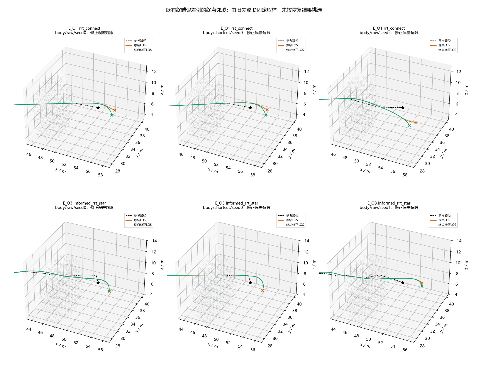
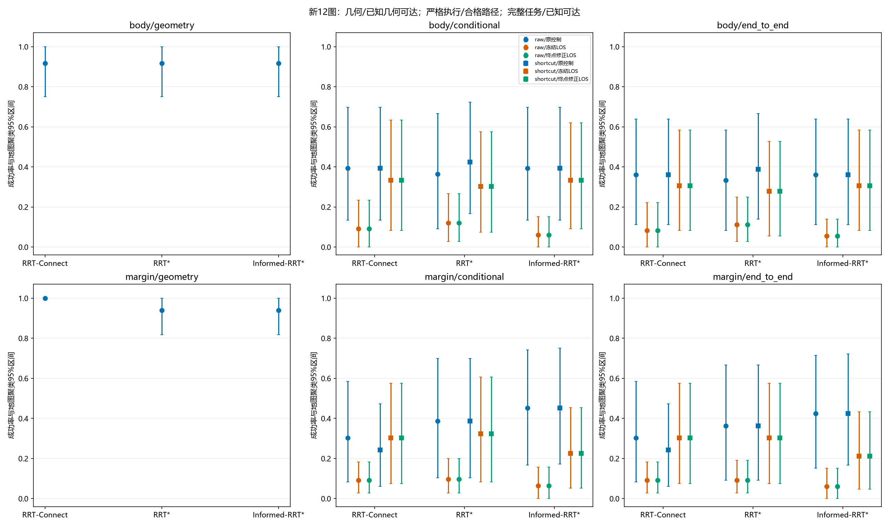

# 阶段5A-F：LOS终点引导修正与基线收口

**阶段决策：A——在当前明确的球包络、固定速度和限幅运动学假设内，基线可用于规划—执行科研比较，可以提交首次原创研究设计审查。** 这不是任意几何路径可执行、通用终点捕获或真实AUV已验证的保证。612个旧路径修正条件、216个新规划任务、1164个新图执行条件及全区间审计已完成；本机483项测试通过，Windows CI和PR信息在交付段记录。本阶段是原评测正确性修复，不是新控制理论或原创RRT贡献，不宣称G-Sunlight完整数值复现或SCI创新已经完成。

## 基线、保护和冻结顺序

从PR #7准确head `c6f911c`创建`audit/auv-stage5af-terminal`，PR目标`audit/auv-stage5ae-evaluation`。研究者确认了超过3文件方案；新逻辑只在`stage5af`，阶段1—5A-E源码/配置/CSV/图/原轨迹只读，不直接改冻结LOS或碰撞核。

| 对象 | 本阶段行为 |
| --- | --- |
| 旧LOS | 组合调用5A-E的Breivik/Fossen三维LOS引导，Δ=2米不变；保留历史前向末端反例 |
| 终端修正 | 最后非零线段内且调用前剩余虚拟弧长≤2米时单向锁存，目标改为实际终点 |
| 车辆/姿态/内环 | 速度1米/秒、航向10度/秒、俯仰5度/秒与±20度，指终点初始航向/零俯仰、比例角度内环均不变 |
| 时间/判据/安全 | 0.1秒、到达0.75米、误差3米、原仿真时长/20秒墙钟保护、球包络/0.25米余量、连续扫掠和任务顶界不变 |
| 路径/规划 | 原306解同源raw/shortcut；新图复用冻结三算法10秒/step5，无新的RRT或三维平滑模块 |
| 工程 | 单一共享执行循环、固定前缀比较、排他记录、OS进程锁、旧轨迹与精确相等前缀复用 |

`83bd0b3`先提交并推送协议/地图配方，随后解析测试；`cb50315`记录通过验收的独立实现；完整开发及安全审计后，`7d71591`提交并推送全部612条件与参数冻结，才生成并查看F_*地图。没有候选扫描，没有根据3/54恢复率增大窗口，没有在独立结果出来后改图、种子或参数。

Gate0实际重跑469测试通过（10.27秒），Ruff/169格式/编译通过。旧360规划与2323条件、929875记录步和627750独立连续区间重新审计；184201原始/CSV字段无漂移，重新派生11表5857行完全一致。先前5A-E的一次资源重叠及单例复核仍作为历史披露，不把复核路径替换为306个主样本之一。

## 修正的数学范围

令L为路径总弧长，s_last为最后非零边起点的弧长，s为调用旧LOS前的虚拟进度。预先定义阈值s*=max(s_last,L−2米)。首次s≥s*时设置terminal=True，以后不回到普通模式；普通模式原样返回旧LOS目标，终端模式返回真实goal。旧LOS的路径坐标、横纵误差和虚拟进度更新仍由冻结函数执行。

当当前位置p≠goal，终端期望方向为goal−p，因此与指向终点的向量内积为其模长平方，严格为正。该性质修正“进度夹到末端后仍沿终段前向延伸”的指令缺口；它不保证实际速度立即朝向终点。固定正速度和受限角速下，目标距离可以先增加，甚至在原3米误差阈值处失败。原光滑路径/理想执行假设下的稳定性定理不能直接用于离散折线、受限内环和锁存切换。

锁存使模式最多切换一次，但指令可存在角度跳变；逐条件保留`maximum_switch_jump_deg`、`terminal_switches`、`terminal_switch_time_s`、`minimum_terminal_goal_cosine`、`terminal_distance_increase_steps`、最后参考进度和位置误差。无速度调度、扩大到达容差、放松误差阈值或关闭认证。

## Gate1正确性与安全验收

实际7个指令场景涵盖越点、极短/零末段、全零路线、上浮下潜和回折；13个实际模型场景包括无遮挡直线、轻偏差、缓圆弧、受控上下浮潜、极短/零路径、航向不齐、急角障碍、前置几何/任务带拒绝，以及**终端已经激活后**的障碍和顶界拒绝。

旧反例终点(10,0,0)、车辆(11,0,0)、末端进度下，旧命令内积−1，新命令内积+1。回折例虽接近最终终点，虚拟进度尚未到末段，不提前切换。已经激活终端的两安全负例均在切换索引0后由原连续认证拒绝，分别归入名义球扫掠和任务带，未绕过安全。适配器对冻结旧入口的状态、控制、终止/误差/饱和指标一致；实际修正的切换前逐步一致，才允许Gate2。

## Gate2：306个旧规划解的完整配对

E_*已被阅读分析，仅作开发回归集。360个旧登记任务仍保留，其中306个有解；其raw/shortcut各运行1个终点修正条件，共612个新增修正条件。原控制与旧LOS的1224个条件只引用，不再搜索。开发表2160个登记条件中1836个真实执行，其余324个未执行占位不是跟踪失败。

| 输入/控制 | 实际条件 | 严格成功 | 名义球扫掠拒绝 | 余量失守 | 误差超限 |
| --- | --- | --- | --- | --- | --- |
| raw/原控制 | 306 | 184 | 66 | 46 | 10 |
| raw/旧LOS | 306 | 196 | 62 | 10 | 38 |
| raw/修正LOS | 306 | 197 | 65 | 10 | 34 |
| shortcut/原控制 | 306 | 200 | 55 | 46 | 5 |
| shortcut/旧LOS | 306 | 219 | 47 | 6 | 34 |
| shortcut/修正LOS | 306 | 221 | 50 | 6 | 29 |

修正raw相对旧LOS恢复1、原成功退化0；shortcut恢复2、原成功退化0。这不能被概括为“没有安全退化”：原终端误差失败中有6个转为扫掠拒绝，且最大误差降低。成功/失败二元配对不足以代表安全表现。

| 同路径开发对照（首→次） | 失败→成功 | 成功→失败 | 成功净变化 |
| --- | --- | --- | --- |
| raw旧LOS→修正LOS | 1 | 0 | +1 |
| shortcut旧LOS→修正LOS | 2 | 0 | +2 |
| raw原控制→修正LOS | 43 | 30 | +13 |
| shortcut原控制→修正LOS | 48 | 27 | +21 |
| 原控制raw→shortcut | 28 | 12 | +16 |
| 旧LOS raw→shortcut | 23 | 0 | +23 |
| 修正LOS raw→shortcut | 24 | 0 | +24 |

原控制→修正LOS包含引导方法差异，不能将43/48次恢复都归功于终点修改。路径处理对照只比较同一raw来源与固定shortcut，不能把它推广为其他平滑方法。完整360任务（包括54个无解占位）均在配对表中，以上标签改变来自306个实际获解任务。`error_improved_but_safety_rejected`是描述性标记，可包括本来就安全拒绝的条件；只有结合首/次类别及独立曲线证据，才判断新出现的安全变差。

54个既有末端相关误差条件中，3个恢复、45个仍误差超限、6个变为名义球扫掠拒绝。完整逐ID证据在[terminal54_paired.csv](../results/stage5af/terminal54_paired.csv)，54是执行条件数，不是54条独立规划路径。恢复的旧条件ID：

- `independent_E_O1_rrt_star_body_seed4--shortcut--los_d2`
- `independent_E_O3_rrt_connect_body_seed1--raw--los_d2`
- `independent_E_O3_rrt_connect_body_seed2--shortcut--los_d2`

转为扫掠拒绝的旧条件ID：

- `independent_E_O3_rrt_connect_body_seed0--raw--los_d2`
- `independent_E_O3_rrt_connect_body_seed0--shortcut--los_d2`
- `independent_E_O3_rrt_connect_body_seed3--raw--los_d2`
- `independent_E_O3_rrt_connect_body_seed3--shortcut--los_d2`
- `independent_E_O3_rrt_connect_margin_seed1--raw--los_d2`
- `independent_E_O3_rrt_connect_margin_seed1--shortcut--los_d2`

这6个修正候选步的独立101点曲线参考均发现名义球模型交叠，最小采样净距介于−0.036713与−0.003682米，不只是“保守认证未决”。原连续认证已经拒绝这些候选步；不把它们算为成功，不宣称车辆已获准驶入障碍，也不把球模型交叠等同实体细长AUV碰撞。逐项证据在`development_failure_reference.csv`。因此，本轮既有3个严格恢复，也有6个误差降低却安全表现更差的条件。

其余45个在同表标为`tracking_error_limit`，不因修正而删除。不能把54个旧“终点相关”条件预先当成54个“可通过本修正恢复”的条件。

开发独立审计612条件、314642个完整区间，1836个首/中/末步RK4核查最大差2.132×10⁻¹³米；306674个切换前步重新比较，7968个终端目标均核对为实际goal，306个raw/shortcut/首证来源复核通过。保存的旧前缀要求精确相等，不将小数近似当数值复用。

## Gate3：新地图与资源门槛

新F_*三类各4张：斜向高挡板、实体空间雕刻S走廊、梯形脊近底地形（完整机体在h与h+6之间）。它们的配方、尺度和任务端点不同于H5/E_*。所有12图的名义球直连均被阻断，名义球几何见证通过；11图margin见证通过，F_N4的2.5米走廊对直径约2.5396米的margin球不可达。见证只证明位置空间可达，不能代替姿态受限可达或作为规划器输出。

正式12图×3seed×3算法×2包络=216规划任务，已知几何可达207、预定margin负例9。每次统一10秒，最多2160秒规划，执行另计。先F_O1/F_N1/F_B1的seed0全部3算法/两包络18任务，完整复用到216；门槛不以成功率高低决定。实际门槛退出0，18/18获解，规划实耗180.145秒，峰值226234368字节、最大超出0.027732秒，未触发技术停止条件。

分母定义固定为：设K为已知位置空间几何可达的登记规划数，G为10秒内获得有效路径数，E为对应处理/控制下合格执行输入数，S为严格执行成功数。几何成功率G/K，条件执行成功率S/E，完整任务成功率S/K。每个相同路径、处理和控制单元单独统计；raw/shortcut与三个控制的重复数不扩大独立地图数。E=0时条件执行率未定义，表中留空，不能写为0%。球包络不可达9任务不进入K，但在216登记任务及1296登记条件中保留。

探索性区间使用预注册RNG65988、2000次整图bootstrap；配对差值按同图同时重采样，允许负差和原成功退化。仅12个合成地图簇，不能把同图三个种子当独立地图，也不据区间作总体显著优越、真实海域泛化或跨机器墙钟规划可重复的承诺。完整每图/方法/包络/处理/控制见逐图CSV，不用总体平均覆盖地图差异。

正式进程实际退出0。216个任务中194个获解，13个已知几何可达任务预算内无解，另9个包络不可达负例；因此几何率为194/207=93.72%，不能用194/216混称已知可达成功率。获解的raw/shortcut×三控制共1164个实际条件，全部eligible；1296个登记条件中的132个未执行，占位不算控制失败。18门槛已包含在216中，旧306解和软件测试也不并入新规划样本。

下表每个控制单元写作**条件执行S/E；完整任务S/K**。同单元几何G/K与控制无关；分子均为严格成功，保留所有失败。

| 规划器 | 包络 | 输入 | 几何G/K | 原控制 S/E；S/K | 旧LOS S/E；S/K | 修正LOS S/E；S/K |
| --- | --- | --- | --- | --- | --- | --- |
| RRT-Connect | body | raw | 33/36 | 13/33；13/36 | 3/33；3/36 | 3/33；3/36 |
| RRT-Connect | body | shortcut | 33/36 | 13/33；13/36 | 11/33；11/36 | 11/33；11/36 |
| RRT-Connect | margin | raw | 33/33 | 10/33；10/33 | 3/33；3/33 | 3/33；3/33 |
| RRT-Connect | margin | shortcut | 33/33 | 8/33；8/33 | 10/33；10/33 | 10/33；10/33 |
| RRT* | body | raw | 33/36 | 12/33；12/36 | 4/33；4/36 | 4/33；4/36 |
| RRT* | body | shortcut | 33/36 | 14/33；14/36 | 10/33；10/36 | 10/33；10/36 |
| RRT* | margin | raw | 31/33 | 12/31；12/33 | 3/31；3/33 | 3/31；3/33 |
| RRT* | margin | shortcut | 31/33 | 12/31；12/33 | 10/31；10/33 | 10/31；10/33 |
| Informed-RRT* | body | raw | 33/36 | 13/33；13/36 | 2/33；2/36 | 2/33；2/36 |
| Informed-RRT* | body | shortcut | 33/36 | 13/33；13/36 | 11/33；11/36 | 11/33；11/36 |
| Informed-RRT* | margin | raw | 31/33 | 14/31；14/33 | 2/31；2/33 | 2/31；2/33 |
| Informed-RRT* | margin | shortcut | 31/33 | 14/31；14/33 | 7/31；7/33 | 7/31；7/33 |

原控制raw和shortcut均74/194=38.14%条件成功、74/207=35.75%完整成功；旧/修正LOS raw均17/194=8.76%、17/207=8.21%，shortcut均59/194=30.41%、59/207=28.50%。旧LOS→修正LOS的388个真实配对条件，恢复0、成功退化0，所有主失败类别均未变；不能把开发集3次恢复称为新图增益，也不能把类别未变等同逐点轨迹未变。

| 新图实际条件 | 成功 | 扫掠拒绝 | 余量失守 | 任务带拒绝 | 误差超限 |
| --- | --- | --- | --- | --- | --- |
| raw原控制 | 74 | 45 | 5 | 0 | 70 |
| raw旧LOS | 17 | 73 | 7 | 9 | 88 |
| raw修正LOS | 17 | 73 | 7 | 9 | 88 |
| shortcut原控制 | 74 | 45 | 7 | 0 | 68 |
| shortcut旧LOS | 59 | 43 | 7 | 6 | 79 |
| shortcut修正LOS | 59 | 43 | 7 | 6 | 79 |

新图原控制raw→shortcut恢复4、退化4；旧LOS与修正LOS均恢复43、退化1，净+42。修正LOS相对原控制raw仅恢复1、退化58，shortcut恢复3、退化18。因此没有“成熟LOS在本离散折线和受限内环上普遍更好”的证据。

逐图修正LOS成功数如下；每个raw/shortcut列的条件分母均为G，完整任务分母均为K。所有控制的逐图完整分层在`map_summary.csv`，不是仅展示修正版本。

| 图 | 已知可达K | 几何G | raw严格成功 | shortcut严格成功 |
| --- | --- | --- | --- | --- |
| F_O1 | 18 | 18 | 0 | 0 |
| F_O2 | 18 | 18 | 0 | 0 |
| F_O3 | 18 | 18 | 0 | 0 |
| F_O4 | 18 | 18 | 0 | 0 |
| F_N1 | 18 | 18 | 0 | 0 |
| F_N2 | 18 | 18 | 0 | 0 |
| F_N3 | 18 | 14 | 0 | 0 |
| F_N4 | 9 | 0 | 0（未执行） | 0（未执行） |
| F_B1 | 18 | 18 | 5 | 15 |
| F_B2 | 18 | 18 | 7 | 16 |
| F_B3 | 18 | 18 | 3 | 13 |
| F_B4 | 18 | 18 | 2 | 15 |

普通类三控制全部严格失败，存在地板效应：raw原控制69误差/3扫掠，raw两LOS均67误差/5扫掠；shortcut原控制68误差/4扫掠，两LOS相同。窄类50个获解输入中原控制raw成功5、shortcut6，两LOS均0；两LOS大部分在扫掠拒绝后停止。近底72个获解输入中原控制成功69/68，两LOS17/59。保留上述难度失衡，不重采样地图；结果只覆盖这组预注册配方，不能外推真实海域或用地板效应宣布算法等价。

完整36控制单元的三类探索性95%区间在`cluster_summary.csv`；42个分方法/包络/因素的配对区间在`paired_cluster_summary.csv`。例如RRT-Connect/body/修正shortcut的完整任务率11/36=30.56%，整图区间[8.33%,58.33%]，条件率11/33=33.33%，区间[8.33%,63.33%]；范围很宽。终端修正的各单元配对差及bootstrap区间均为0，这仅反映本批观测没有成功标签变化，不是未来地图等价性证明。

216次搜索实际总耗时2161.910秒，单次最大超出0.057322秒，RSS峰值253771776字节（约242 MiB）。每次证书仍须在10秒内生成；预算后封装/退出开销不被伪装成额外有效搜索。CPU单核、数值线程1、普通优先级，不使用GPU；执行和审计耗时另计，完整逐次耗时保留。

## 最终安全、运动学和图表复核

新图独立审计实际退出0：216个规划、194个获解来源、1164个记录，434493个完整步/区间重新认证，3492个独立RK4步最大位置差1.7053×10⁻¹³米；128442个切换前步再比对，1295个终端目标核对为实际goal。无预算后首证、来源漂移、速度/角速/俯仰越限、安全判据绕过或认证失败仍计成功。开发审计另列，不能把旧记录重审次数包装为新实验样本。

392个新图首次安全失败区间包括322个名义球扫掠、30个任务带、40个额外余量失守。独立曲线参考中，扫掠318个有球交叠样本、4个为未决接触带；任务带28个有任务几何交叠样本、2个未决；40个余量失守均有扩大球/任务几何交叠样本。未决不是安全证明，也不冒充已证碰撞；不能由这些球模型结果推断细长实体AUV的姿态碰撞。严格成功条件的所有区间保留原连续认证，失败候选未被作为获准执行的安全步。

六张PNG均已逐一打开检查，标题、坐标单位、图例和失败位置可读。`figure_manifest.csv`固定旧O1/O3各前3个失败ID，以及F_O1/F_N1/F_B1的seed0/body、全部三方法及两输入；未按恢复选图。首次绘图的NaN柱没有显示“未运行”，仅修正显式文字后重绘，数据未变，`figure_qa.json`保留检查。图中稀疏背景和显示点不是碰撞真值。

## 已发现的边界与阶段决策

已证实指令方向修正和认证保持，但不能宣称通用终点捕获保证。2米窗口按旧Δ预注册，并非按实际机动需求推导的通用可达距离。在水平零俯仰近似下，v=1与10度/秒对应转弯半径约5.73米；俯仰角速5度/秒也限制短距离内的姿态调整。进入终端时的目标方位/俯仰、机体实际朝向、窄安全间隙及3米误差终止规则可能共同限制捕获；不能为了提升数字临时放松它们。

只读`terminal_mechanisms.csv`保留全部实际修正条件，记录切换时的目标距离、航向/俯仰方位误差、实际速度方向与目标夹角、终端最小距离及距离增加步数，并用首次失效时间区分切换前/后。期望命令的目标余弦与实际速度余弦是两个指标；前者为1不推出后者立即为正。该分析不新增模拟、不调参数，静态方位角也不作为车辆运动学不可达的证明。

54个开发终端相关条件均实际触发一次切换。3个恢复例的终端最小距离为0.6906—0.7437米，进入0.75米到达球；45个仍误差超限例的最小距离为0.7964—2.8533米，全部未进入到达球，并出现13—32步距离增加。其切换目标距离中位数2.5943米、航向误差中位数54.57°，16例瞬时目标俯仰绝对值超过20°。6个转扫掠例切换目标下潜角为−49.95°至−42.15°，不能由±20°内环瞬时实现。目标方向正确不消除这些状态约束；这些是实际观测和尺度解释，不是固定容差下全任务不可达证明。

新388个修正条件仅94个激活终端，76个成功、14个已在切换前失守余量、4个终端误差失败；其余294个在激活前结束。312个失败条件中308个首次失效在终端前，故本批剩余失败的主要位置不是末端前向引导缺口。4个终端误差失败为`F_B1/rrt_star/body/seed1/raw`、`F_B1/rrt_star/margin/seed0/raw`、`F_B1/rrt_star/margin/seed2/raw`、`F_B3/rrt_star/body/seed1/raw`；其中最后一例切换航向误差90.62°、另一例瞬时目标俯仰66.46°。它们保留在逐次CSV中，不能靠扩大到达阈值抹除。

| 机制 | 已证实事实 | 尚不能推出的结论 |
| --- | --- | --- |
| 终点引导 | 原前向反例消除，锁存最多一次，正常段一致；旧3次恢复、新0次成功标签变化 | 任意初态/路径均能到达；全54例应恢复 |
| 路径结构与限幅 | 新普通类144个修正输入均在终端前失败，其最大段俯仰28.99°—84.94°，均超过冻结20°；最大拐角中位数69.82° | 存在3米跟踪容差时，所有这些任务在运动学上不可达；不能仅凭最大段俯仰证明 |
| 局部间隙 | 新窄类100个修正条件全部在终端前失败，首次失效局部参考保守净距中位数0.5750米、最近误差中位数2.1994米；拐角中位数87.54°；扫掠参考多数有实际球交叠样本 | 球包络完全代表真实细长机体；所有接触均已确定 |
| 控制适用范围 | 同路径上原控制、LOS和处理选择有恢复也有退化；shortcut对新LOS恢复43、退化1，明显大于本轮终端修正的0次新图恢复 | LOS理论错误或实现错误；参数优化一定无效；任何单一因素占比已被识别 |
| 机体/平台模型 | 9个margin负例确为位置空间包络不可达，独立排除；其余仅为未标定仿真假设 | 当前主要失败已被证明来自球包络过保守，或已有真实平台标定 |

**选择A；“是否具备进入首次原创设计的可靠基线”的回答为“是，限上述仿真假设及科研设计审查”。** 基线可信的依据是有限路径指令定义、软件/运动学/安全正确性与真实失败的可追溯性，并非成功率高。依任务书A的判据，剩余失败集中在终端前的低间隙、急角、段俯仰和受限姿态，且同源路径处理确实改变执行结果。45个开发末端失败及4个新末端失败是固定正速度、限幅与切换状态下保留的适用边界；不能据成功未恢复就认定模型软件错误，也不能假定它们已解决。

未发现未解决的引导实现、积分或安全正确性问题；固定速度/角速度的适用边界已经量化，并作为本轮科研比较的明确条件保留，所以采用任务书A的限域比较口径。B也涵盖模型适用边界仍妨碍研究目标的情况：若研究者要求任意末端状态保证捕获，本轮证据不足以批准该更强目标，需另立适用域与模型验收，不能从本轮A外推。也没有真实姿态碰撞/平台对照足以选择C为已证主因。本轮没有新的航速、前视、初态单因素扫描，不能定量分摊各因素的因果贡献，也不否认后续控制或机体标定的价值。

下一阶段只建议研究者审查一个候选问题：**固定限幅下，局部拐角/俯仰可执行性与安全间隙的规划—轨迹协调**。首先进行2025—2026相关文献查新、强基线选择和消融预注册，确认是否存在原创空间；这是研究设计建议，不是已有创新算法，也不保证SCI结果。本轮不再开启大参数试错、不在F_*图上选参，不实现洋流、MPC、强化学习、Attention或新RRT。5A-F交付后停止，等待研究者与ChatGPT审核。

## 实施异常与数据完整性

Gate1补强用例曾因插入位置错误实际2失败/1通过，修复后再验收。首次pilot在第一个条件计算完成后的保存阶段遇到NumPy布尔序列化错误；部分gzip和日志原样保存在`local_only/stage5af/serialization_failure`。显式Python bool和完整轨迹JSON回归后，新增核心9项通过，再运行门槛及全量。额外未归档执行尝试1次单列，不增加独立样本，不覆盖部分文件、旧成果或替换种子；没有发生重复worker竞争。

完整原轨迹/新后缀在仓库外单份，公开CSV/PNG和自编代码。失败轨迹最后一步可能是被拒绝候选末位置，不代表批准执行到该处；球包络交叠也不等于细长实体AUV碰撞。尚无真实平台标定或海试证据。不生成额外文件hash清单。详细命令、测试及最终PR/Windows CI证据另列。

## 质量和交付

本机实际483 passed in13.62s，Ruff、190文件格式及compileall均退出0；完整JUnit和日志留在`local_only/stage5af_audit`，公开`local_checks.json`与逐项`pytest_results.csv`。360旧规划的预算/半径/首证新增断言另做只读补验，通过而不重复314642个开发区间。

发布前`git diff --check`通过；相对PR #7的历史跟踪文件修改/删除为0，所有候选文件仅在新stage5af范围，凭据模式扫描无命中，未纳入完整轨迹、作者材料、环境或额外hash文件。完整原始1776个新条件档案中1000个采用精确前缀引用，复用435116步；后处理仅保留汇总元数据，避免在内存中重复囤积完整轨迹。

分支为`audit/auv-stage5af-terminal`，PR以`audit/auv-stage5ae-evaluation`为目标，保持开放未合并。官方Windows CI与PR地址将在发布后实际核验并补充；不会仅凭本机检查声称Windows CI已通过。
