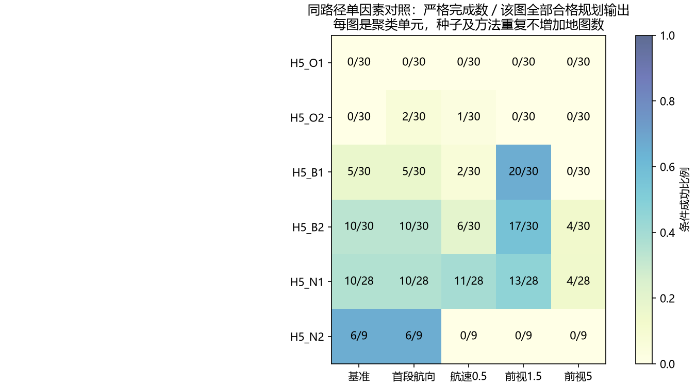

# 第五阶段5A-R：规划与跟踪一致性及执行失败归因

**研究决策：Refine Evaluation（先完善评测协议）。** P0—P3已实际完成。现有证据最支持“几何折线、局部安全间隙与固定跟踪器/姿态限制之间的不一致”，不能把失败统一归于初始航向，也不能把降速或缩短前视称为通用解决方案。本阶段没有发现能解释5A执行失败的运动学积分或几何认证错误；发现并修复了一处新增CSV导出ID覆盖错误，数值结果与原始轨迹不变。

## 1. 范围、版本和证据

基线为[PR #5](https://github.com/Whsjbwy/erqulunwengfx/pull/5)的8c69bb5。独立分支为audit/auv-stage5ar-execution，PR目标pivot/auv-rrt-stage5a。方案经研究者明确确认；30d39d5在任何本阶段场景重放之前提交并推送协议、P0结果和固定取样清单。

已检查5A的全部核心模块、测试、协议/地图/选参配置、中文报告、7个阶段提交及450份本地完成记录。完整路径和原始执行从本地result.json读取，未从精简CSV推测坐标。重新审计13185条归档路径条目、13633条历史引用、1305个截点；另核对450份原始row与公开runs.csv的33670字段，均一致。旧阶段源码、配置、CSV、图及历史中止记录未改写。

沿用长2米、直径0.4米假设圆柱的方向无关球包络R=sqrt(1.04)≈1.0198米，margin为0.25米；无洋流、正向定速运动学。航向/俯仰速率10/5度每秒、俯仰20度、步长0.1秒、增益1、目标0.75米、误差阈值3米均冻结。它不是标定车辆、6DOF或海试模型。

本阶段没有重新搜索。正式270任务仍是6张图×5个规划种子×3方法×3尺度；15个margin包络负例（每方法5个）单列。90条point选中路径均执行前几何拒绝，不能算90次实际跟踪失败。23个正式无路径任务包含15个已认证包络负例和8个可达预算未获解。

## 2. P0：模型与认证先验验收

先运行解析测试，再执行T01—T08数值验收，全部通过后才冻结清单、开展场景重放。复用原版State、integrate、chord_error_bound、Route、Geometry；原track不修改。由于旧track没有逐步记录/初始姿态接口，新增明确的诊断循环，并逐项核对基准与原函数/历史记录，避免静默改变模型。

| 案例 | 预定验收及实际证据 |
| --- | --- |
| T01 对齐直线 | 30米直线293步、29.3秒，终点误差约0.7米，偏差近0；符合0.75米到达和原状态更新顺序 |
| T02 初始偏航不一致 | 正确向首段转向，角速受限；本例触发3米误差阈值，不预设必须成功 |
| T03 水平90°圆弧/三维积分 | 两档速度符合R=v/ω解析位置；5组角速组合与独立小步RK4最大差8.832×10⁻¹³米，低于10⁻¹⁰米容差；曲线中间点被弦误差界覆盖 |
| T04 S形 | 前视插值端点正确，实际出现正负角速±10°/s；连续反向需求可导致误差超限，不能把限幅通过当路径成功 |
| T05 上浮/下潜 | z向上、弧度/角度及俯仰裁剪一致，两方向受20°限制 |
| T06 接触与边界 | 面/棱/角接触拒绝，邻近自由点通过；闭工作空间边界与越界区分；额外保守包络拒绝的解析例，经独立距离下界仍认证曲线安全 |
| T07 名义/额外余量 | 名义球可完成而额外0.25米不合格，分类为margin_only_failure |
| T08 几何有效尖角 | 前置几何有效，受限转向仍误差超限，未误报严格执行成功 |

T06的额外包络例是解析分类验收，不是5A保守误拒绝频率。历史闭体素检测、各向异性spacing、长线段、独立凸距离参考等原有测试也实际重跑。有限测试通过不构成“所有可能输入绝无bug”的证明。

最终另从1099个执行条件记录重建361456个记录步（含引用），检查时间、位置连接、角速/俯仰限制、饱和、误差和停止次序；首/中/末共3297步与独立RK4最大差9.973×10⁻¹⁴米。证据见[解析结果](../results/stage5ar/p0_analytic_results.json)、[逐步审计](../results/stage5ar/trace_audit.json)。

## 3. P1：冻结路径和首次失败

[sampling_manifest.csv](../results/stage5ar/sampling_manifest.csv)有517行，覆盖正式270任务曾被评估的raw_best/selected唯一ID及无路径任务；不是把所有未执行incumbent声称已跟踪。先按历史结果类别、地图和最早/最晚规则冻结18条首轮路径，覆盖三类地图、成功及现有不同失败类型。普通障碍本来没有成功类别，未伪造该类覆盖。

首轮18条通过原版/历史一致性后，按事前规则整体扩展到157条名义机体合格selected路径：body84、margin73；包含普通障碍全部60条。首轮不替换失败案例，未依据新结果选种子。全部157条基准与原track及历史结果/数值一致。

| 基准主类 | 路径数 | 解释 |
| --- | ---: | --- |
| success | 31 | 名义任务与模式要求的余量均完成 |
| swept_safety_reject | 83 | 首次连续扫掠不能认证，不能仅凭标签称真实碰撞 |
| margin_only_failure | 29 | 已名义完成，但未全程保留额外0.25米 |
| tracking_error_limit | 12 | 首次最近折线距离超过3米 |
| mission_band_reject | 2 | 任务顶界认证拒绝，非物理障碍碰撞 |

对83个物理拒绝区间，独立点到闭盒距离计算在精确曲线上采样101个时刻，全部发现名义球模型交叠。对2个任务带拒绝区间，独立下界认证物理部分安全，同时任务顶界存在球模型交叠。这支持分类正确；仍不能推断真实细长车辆的碰撞或实体轨迹。

首次事件以0.1秒区间起止和候选末状态记录，不把末状态叫精确碰撞点。原版先更新状态再判拒绝，因此最大/RMS误差和间隙包含被拒绝的候选步；不是所有已接受状态均已发生相同越界。first_task_band_*只指顶界，first_mission_*对应包含物理检查的组合验证器。

基准中93条出现航向饱和、112条出现俯仰饱和，实际角速/姿态限值无违例；限幅导致0违例不能说明跟踪可行。83个物理拒绝样本的最大误差中位约1.892米，29个仅余量失败样本约0.275米，说明小于3米的误差仍可能耗尽局部间隙。

## 4. P2：完整单因素配对结果

五个条件使用完全相同的157条路径、地图、任务、球模型和安全规则；只改一个输入。仿真上限沿用min(600,max(60,3L/v+30))，每次上限和600秒截断标志均在CSV明示。没有模拟未到达或资源超时，本阶段比较未受时间耗尽主导。

| 条件 | body严格/84 | margin严格/73 | 全体严格/157 | 名义完成/157 | 相对基准恢复/丢失 |
| --- | ---: | ---: | ---: | ---: | ---: |
| 基准：终点航向，v=1，前视3 | 19 | 12 | 31 | 60 | 0 / 0 |
| C1：仅初始航向对齐首段 | 20 | 13 | 33 | 70 | 2 / 0 |
| C2：仅航速0.5 | 11 | 9 | 20 | 55 | 4 / 15 |
| C3：仅前视1.5 | 32 | 18 | 50 | 65 | 40 / 21 |
| C3：仅前视5 | 7 | 1 | 8 | 19 | 1 / 24 |

这是合格历史路径的诊断总体，不是混合尺度算法总体成功率。body基准按三方法仍为11/7/1，margin仍为7/5/0，与5A一致。未获几何解和执行前拒绝的任务仍保留在历史分账，不能用157替换其规划分母。

| 地图 | 本图合格路径 | 基准 | 首段航向 | 航速0.5 | 前视1.5 | 前视5 |
| --- | ---: | ---: | ---: | ---: | ---: | ---: |
| H5_O1 | 30 | 0 | 0 | 0 | 0 | 0 |
| H5_O2 | 30 | 0 | 2 | 1 | 0 | 0 |
| H5_B1 | 30 | 5 | 5 | 2 | 20 | 0 |
| H5_B2 | 30 | 10 | 10 | 6 | 17 | 4 |
| H5_N1 | 28 | 10 | 10 | 11 | 13 | 4 |
| H5_N2 | 9 | 6 | 6 | 0 | 0 | 0 |

首段航向恢复10条名义完成，其中只有2条同时满足严格余量；所以它有作用，但不能解释全部失败。前视1.5在两张近底图改善明显，却丢失N2的6个基准成功；其40恢复与21丢失均保留，不能只报净增19。航速减半使近水平最大角速下参考半径由5.73降至2.86米，严格完成仍减少，证明这一半径不是折线任务执行的充分条件。没有测试组合设置，也未在同批历史路径上继续调增益或寻找最优参数。

## 5. P3：真正同源shortcut

每个任务从同一raw_best坐标派生一次固定最远可见顶点greedy shortcut，使用原规划半径；不是拿历史不同incumbent直接作前后比较。157组两侧均独立通过名义机体认证，本总体未出现单侧几何不合格。初始姿态及跟踪器相同；时限均用原长度公式，各次均未因时限终止。

| 地图 | 配对数 | raw严格完成 | shortcut严格完成 | 恢复/丢失 |
| --- | ---: | ---: | ---: | ---: |
| H5_O1 | 30 | 0 | 0 | 0 / 0 |
| H5_O2 | 30 | 0 | 0 | 0 / 0 |
| H5_B1 | 30 | 2 | 4 | 3 / 1 |
| H5_B2 | 30 | 8 | 11 | 5 / 2 |
| H5_N1 | 28 | 3 | 12 | 9 / 0 |
| H5_N2 | 9 | 2 | 5 | 3 / 0 |
| 合计 | 157 | 15 | 32 | 20 / 3 |

157组均缩短、减少段数；平均长度差−2.550米。最大折线转角在39组增大、113组减小、5组不变；最短段在150组变长、7组不变。最小任务间隙下界在58组降低、54组增大、45组不变。缩短路径既可能恢复，也可能破坏执行，不能预设shortcut必然制造尖角或必然改善安全。

本配对支持“这种固定后处理会改变本模型的执行结果”，但它同时改变长度、转角、段长和局部间隙，不能把20条恢复唯一分配给某个形状指标。来源ID、顶点索引、全部转换及负例见[shortcut_pairs.csv](../results/stage5ar/shortcut_pairs.csv)。

## 6. 归因判断与未确定部分

**已证实：**

1. 给定解析案例、独立参考和冻结重放未发现可解释旧5A失败的积分/扫掠实现错误；旧执行结果可重复。新增CSV导出错误属于追溯字段错误，不能拿它解释模拟失败。
2. 固定前视、初始航向和速度对同一路径确有影响，且存在大量反向案例；“只要降速”不成立。初始航向不是全部失败的充分解释。
3. 全157条中63条包含超过20°的段俯仰；普通障碍60条中42条存在这种需求，40条首段需求超过20°。在当前模型中不能以零误差严格沿这些直线段运动，规划几何没有保证姿态/转向一致性。允许偏离后是否存在可执行轨迹并未被否定。
4. 局部间隙而非统一误差阈值决定部分失败。N2孔宽2.5米，球直径约2.0396米，居中名义余量仅约0.2302米，额外0.25米包络不可达。名义可达仍需要局部跟踪误差与通行几何相容。
5. 同源后处理的20条恢复和3条退化证明路径结构是影响因素之一，但它不是独立于控制器、姿态和间隙的唯一原因。

事后解释图按“基准成功、C2失败的N2任务中job_id最小者”选取，明确不用于选参。该路径基准最小间隙下界约0.01829米；降速后最大偏差约0.61166米，前视1.5后最大偏差约0.35073米，均发生名义扫掠拒绝。它说明小误差仍可不安全；不是总体因果比例估计。[局部对照图](../results/stage5ar/narrow_failure_detail.png)及选择记录均公开。

**尚未确定：** 初始俯仰、角度增益、速度与前视的交互、其他固定控制基线、标准平滑方法、姿态相关胶囊体、真实车辆参数及水动力的影响。本阶段未开展可选C4、组合调参或新控制器；不能据此给出各因素互斥的原因百分比分解，不能说“RRT*无法执行”或“其他控制器无解”。球模型的交叠证据也不等于实体细长机体碰撞。

[path_geometry_associations.csv](../results/stage5ar/path_geometry_associations.csv)给出每图转角、段长、俯仰、初始偏差、间隙与结果的描述关联，以及6个地图均值的关联；常量/缺失相关为空。方法、模式与几何因素可能混杂，未作显著性或因果宣称。

## 7. 软件质量、异常和资源

本机Windows 11、Python3.11.15，CPU串行、线程1、无GPU训练。新逐步轨迹保存为1099个条件记录，其中85个引用复用，实际1014份积分轨迹，共62071068字节（约59.20MiB）；历史大文件不复制。新搜索0，资源超时0。没有额外文件hash、作者资料或环境文件进入公开交付。

最终本机450项测试通过9.07秒；Ruff、143文件格式和compileall通过。逐项与退出状态见[测试记录](STAGE5AR_TEST_RESULTS_CN.md)、[local_checks.json](../results/stage5ar/local_checks.json)。5张PNG均实际打开核对，仅调整障碍显示、留白和局部放大；未改变地图、轨迹、种子或认证规则。

最终检查曾实际发现CSV扁平化覆盖全局路径ID：448通过、1失败。先以b563a8c提交最小失败测试，再修复，保留修复前CSV/日志。修复后157个派生全局ID均唯一；共有非ID字段逐项不变，raw/shortcut成功仍为15/32，无轨迹重算。详见[export_repair.json](../results/stage5ar/export_repair.json)。此问题与旧5A执行模型分开报告。

## 8. 下一阶段审核建议及停止边界

选择**Refine Evaluation**。先审核初始姿态、局部误差/安全管、俯仰需求和控制评测基线，避免把历史固定控制设置包装成规划创新。前视1.5不是新的默认最优参数；需要独立开发任务选择协议，再以全新地图/配方/任务分布验证。

若协议修正后仍出现几何尖角和安全间隙损失，可在研究者批准的下一阶段引入已发表的标准平滑或运动约束steering作强基线；先比较成熟方法，不命名新算法。若球包络支配关键任务可行性，再单独评估姿态相关机体模型的适用性及代价，保留本阶段球模型历史。

每类仅2张地图，5个规划种子是图内重复；6张图已用于归因，不再是未见留出集。没有海试或泛化结论，不提供录用概率或预期提高比例。本阶段不增加洋流、MPC、Attention、强化学习或新RRT算法。完成5A-R后停止，等待研究者审核；不合并任何历史PR或main。
