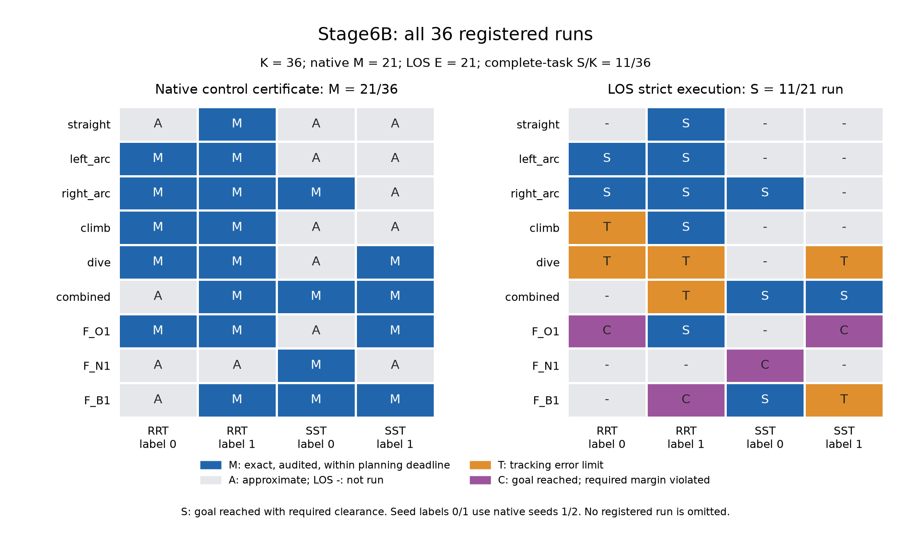
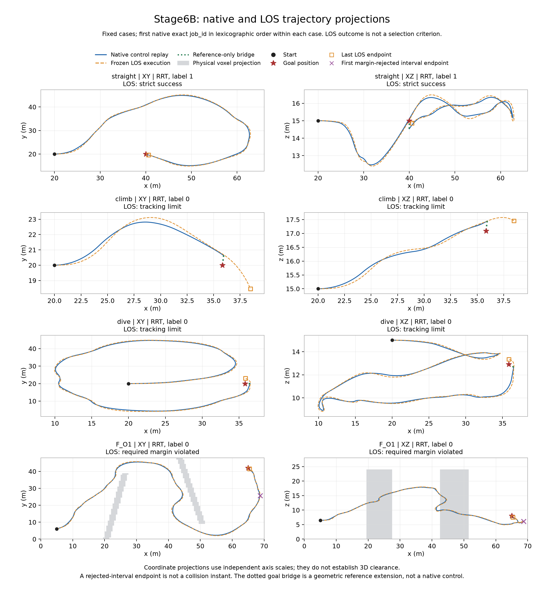

# 阶段6B：OMPL强基线复现与模型一致性验证

**最终科研建议：Need More Evidence。** 官方OMPL `control::SST`和`control::RRT`已经在Windows原生构建，并实际产生经过完整连续安全认证的五状态AUV控制轨迹。本阶段解决了6A“尚未原生运行”的证据缺口；当前证据仍不足以批准H1原创实现，原因包括近邻全文缺口、基线配置覆盖有限，以及模型可行轨迹与冻结LOS参考契约之间仍有明确差异。

本阶段真实执行了13例接口验收和36次开发冒烟搜索。没有运行324次论文矩阵，没有重新搜索挑种子，没有更换历史地图或改控制器。本文的数值为开发检查结果，不是独立测试集性能、SST最优性证明或算法优劣结论。

## B0：实际完成的原生构建

基点为[PR #9](https://github.com/Whsjbwy/erqulunwengfx/pull/9)准确提交`4553d0f7e14207c92eb69dafd444cfdab395bcf7`。6B分支为`research/auv-control-baselines-stage6b`，目标为`research/auv-executable-planning-stage6a`；阶段1—6A保留。

本机最初没有可用C++编译器、CMake或Ninja。按研究者确认的方案，在D盘仓库外隔离目录使用LLVM-MinGW 20261104（Clang 23.1.5）、CMake 3.31.8、Ninja 1.13.2，原生编译Boost 1.89.0、Eigen 3.4.0和官方OMPL 2.0.2；没有系统级安装、全局PATH修改或WSL切换。JSON桥接使用外部nlohmann/json 3.12.0。

编译链接的是官方SST/RRT源实现，不是自编简化树。外部源码未进入Git，自编内容仅为五状态模型、完整区间认证、目标/接口和记录程序。官方`ControlDurationObjective`在恒速1 m/s时等价于控制弧长代价；用官方无限成本阈值停止于首次有限exact解，因此这里是**可行性冒烟**，不是充分优化后的SST性能比较。

实际构建记录包含21条编号命令，其中6条失败、15条成功，以及另一次诊断调用。失败涉及路径转义、中文路径与编译器输出解码、Windows目标API版本和Boost头文件模块不足；均保留原日志后修复。官方OMPL、适配器最终编译成功，CTest 1/1通过，内部含6组显式模型/几何测试。关闭上游完整测试和可选VAMP，不声称跑过OMPL全测试套件。[构建与许可](STAGE6B_BUILD_CN.md) · [实际命令](STAGE6B_COMMANDS_CN.md)

## B1：相同模型与真正的传播安全链

状态为`(x,y,z,yaw,pitch)`，输入为两Euler角速度。速度1 m/s、航向率10°/s、俯仰率5°/s、俯仰角±20°、0.1秒步长、0.75米目标位置球、`sqrt(1.04)+0.25 m`有效半径全部保持原值。速度是固定参数，不因存储时附带第六个数值而成为六状态动力学；模型没有滚转、水动力、制动或实物辨识。[模型映射表](STAGE6B_MODEL_MAPPING_CN.md)

每个0.1秒区间进行解析常值控制积分，并用曲线弦偏差包络、完整线段—闭体素盒距离、车辆球和任务顶界认证。真实OMPL传播器不能倒退；失败写出有限越界状态，并由明确的有效性检查拒绝。B1不仅调用独立公式，还核查真实`SpaceInformation::propagateWhileValid`的接受步数与返回状态，避免不安全段恢复到自由端点后被误接入树。

`7c77345`在接口运行前登记输入；`5b04e39`在搜索前冻结代码和安全证据。实际13/13符合预期，接受930个区间、真实适配propagator调用936次。原生与冻结Python逐步状态比较最大差为0；28个独立RK4抽查最大位置差为`1.2079226507921703e-13 m`。[逐例CSV](../results/stage6b/interface_cases.csv)

第13例在不改变0.1秒、1 m/s或球半径的情况下构造了“端点都自由、中点球相交”的区间。独立几何检查确认中点净距约`-0.0004 m`，整段被真实适配器拒绝。这是对端点检查漏洞的直接反例；拒绝区间的候选终点不能解释为碰撞瞬时位置。[中段证据](../results/stage6b/middle_collision.json)

## B2：36次真实搜索与完整分母

固定6个6A给定控制正例与3个旧F开发图，各用两算法和两个种子标签。标签0/1事前映射到原生种子1/2，避免OMPL将seed=0自动替换为1；每任务启动新进程，先设置种子再构造RNG。已知控制只用于确定任务和验收，没有放进规划器请求。旧F图只具有位置空间几何见证，不能称为同初态运动学已知可达。

两次直线pilot均为approximate，安全重放通过但未计成功。随后原位复用这两次结果，完成其余34次。总计36次，每个登记任务只有一个完整目录，未发现部分、错误或额外任务目录。[逐次CSV](../results/stage6b/planning_runs.csv) · [清单](../results/stage6b/search_manifest.json)

| 官方算法 | K登记搜索 | M严格原生可行 | M/K | E实际合格LOS执行 | S严格LOS成功 | S/E | S/K |
| --- | ---: | ---: | ---: | ---: | ---: | ---: | ---: |
| control RRT | 18 | 13 | 72.22% | 13 | 7 | 53.85% | 38.89% |
| control SST | 18 | 8 | 44.44% | 8 | 4 | 50.00% | 22.22% |

执行总账为K=36、M=21、E=21、S=11。该合计混合了算法和任务，只作交付计账。9个任务不等于9张独立地图：6个解析任务复用空旷网格，另3图来自已经用于开发的F图。两个种子也不是独立地图重复，不报告显著性或推广优越性。[分组统计](../results/stage6b/rates.csv)

其余15次全部为approximate，没有升级为exact。其中4条在独立证书完成时超过10秒，另11条为未到达目标球的普通近似解。4次晚证书分别为10.4532、10.5373、10.7837、11.1559秒，全部保留截止失败；没有声称每个进程都被硬截断于10秒。规划搜索最多8秒，预留2秒属于同一10秒预算。所有21个严格原生成功均在总规划截止前完成认证。[失败统计](../results/stage6b/failure_counts.csv)

所有返回控制序列，包括15条近似轨迹，都独立重建并重认证。只读完整审计复查了27661个原生区间、16259个已保存LOS区间；独立RK4分别108和63个抽查区间，最大位置差分别约`8.5265e-14 m`与`8.6460e-14 m`。未发现原生轨迹或宣称严格成功的LOS轨迹存在安全假阳性。[完整精简审计](../results/stage6b/trace_audit.json)

图中A表示近似返回，不能作为严格成功；其中晚证书由CSV和审计单列。S/K使用全部登记任务，不能用S/E代替。

## B3：原生可行不等于冻结LOS可执行

每条原生控制序列按0.1秒独立重建位置参考，参考弦另做完整余量认证，不平滑、不缩短路径。6A左右弧保持yaw=0初态，不被默认goal-facing初始化改成±45度；旧F任务也使用双方共同的历史初态。

由于原生解只需进入0.75米目标球，而冻结LOS入口要求参考精确终止在真实goal，契约明确允许追加至多0.75米且单独认证的参考桥段。该桥段不属于原生控制、不计入M，也不改变scene.goal。实际21条桥段均通过，长度约0.3291—0.7497米；没有桥接失败的条件被偷偷计入E。

严格S还同时受20秒参考适配/LOS截止和30秒总流程截止约束，不能仅以到达或控制器返回值判成功。21条原生可行轨迹中11条LOS严格成功，10条失败分为：

- 6条`tracking_error_limit`，实际误差超过冻结3米阈值；
- 4条`goal_reached_required_margin_violated`，虽到达目标，但全程0.25米额外安全余量没有保持，严格判为失败。

冻结模拟器保留了这些失败轨迹；到达、名义机体安全和保持所需余量是不同字段。不能把4条余量失守写成安全成功，也不能把它们误报为原生规划树接受不安全段。全部实际失败区间和候选位置均保留。[失败原因](../results/stage6b/failure_counts.csv) · [末端诊断](../results/stage6b/terminal_diagnostics.csv)

**已确定的参考契约交互：** 冻结`TerminalLOS`的切换进度为`max(最后非零边起点,L-2m)`。在本次密采样参考加末端桥段时，最后边通常就是桥段，因此切换剩余弧长为桥长，而非固定提前2米。现有记录中6条跟踪误差失败均在terminal激活后失效，4条余量失败及11条严格成功均未激活terminal。源码关系和记录共现已经核实，但没有运行改变采样/控制器的因果对照，不能据此认定唯一原因或宣称完成了新的控制修复。

四任务按预定场景及首个exact的job_id字典序选取，LOS结果不是筛选依据，包含1个成功与3个失败。投影不证明三维安全；紫色端点是首个余量拒绝区间的候选端点，不能解释为精确碰撞时刻。全部36条件参与统计。

原生返回轨迹可能明显绕行。这里停止于首个可行解，没有证明轨迹接近最短或基线已经充分调参。[逐次轨迹指标](../results/stage6b/trajectory_metrics.csv)分开记录原生控制弧长、解析见证长度、LOS已积分弧长、余量认证前缀、限幅和饱和。LOS已积分弧长包含末候选区间，不能当作全程安全路程；未执行LOS的指标为空。不能只比较共同成功子集后忽略失败。

## 文献补证据与研究判断

本次确实找到了作者团队的control DIRT：[PRACSYS项目页](https://pracsys.github.io/projects/)链接[ML4KP](https://github.com/PRX-Kinodynamic/ML4KP)，MIT许可。默认代码包含DIR选点、blossom多候选、统一整步随机时长；其默认轨迹检查和二维目标不能直接当成本项目三维连续安全强基线。OMPL PR #1340仍为未合并geometric DIRT，不是已合并control DIRT。

已读默认DIRT/RDG机制中没有核实到与H1完全相同的净距—姿态联合条件化时长，但这不是新颖性证明。Feng2024正文仍未合法获取，RDG官方代码/许可仍未定位；不把DOI、摘要或可替换扩展接口当作排除等价先验的证明。[逐项补查与来源](STAGE6B_LITERATURE_AUDIT_CN.md)

因此选择 **Need More Evidence**：

1. Windows原生、同模型、同安全的成熟实现已可审查使用，构建门槛通过。
2. 当前只是两种子、固定配置、首解式开发冒烟；不能由13/18与8/18宣布RRT优于充分优化的SST。
3. 原生可行与统一LOS成功相差10条，后续必须先审核共同参考采样、终端契约和主要评测对象，不能把接口差异当作H1收益。
4. 近邻正文/现代对照覆盖尚有缺口；H1的新颖性和有效性都没有证明。

后续建议提交证据与评测契约审查，再决定是否另开阶段授权最小H1原型。本阶段不继续LOS扫参，不开发H1，不修改车辆几何或升级六自由度模型来追求成功率。

## 工程交付与停止

实际质量检查与Windows官方构建/13例CI以[测试记录](STAGE6B_TEST_RESULTS_CN.md)及机器证据为准。原始构建失败日志、源码依赖、完整控制与LOS轨迹留在仓库外单份；Git仅收录自编代码、精简结果和两张必要PNG，无额外文件hash清单。历史修改/删除范围见`results/stage6b/delivery_review.json`。

[PR #10](https://github.com/Whsjbwy/erqulunwengfx/pull/10)以6A分支为目标，供研究者与ChatGPT审核，不合并main。完成6B后停止，不进入原创算法实现。
