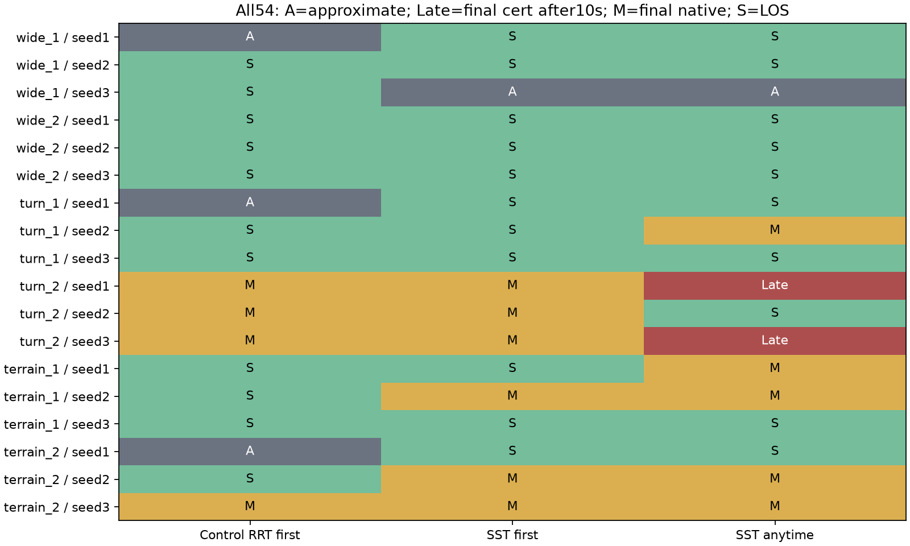
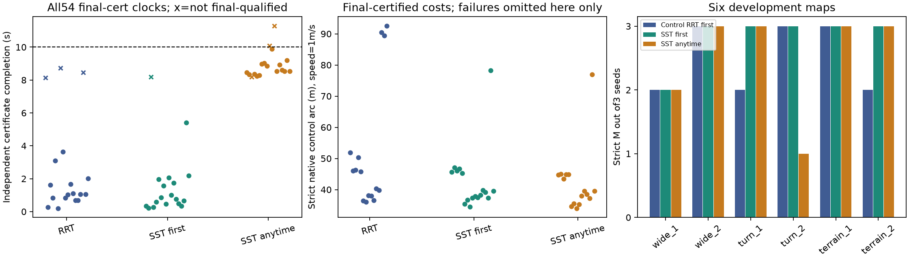
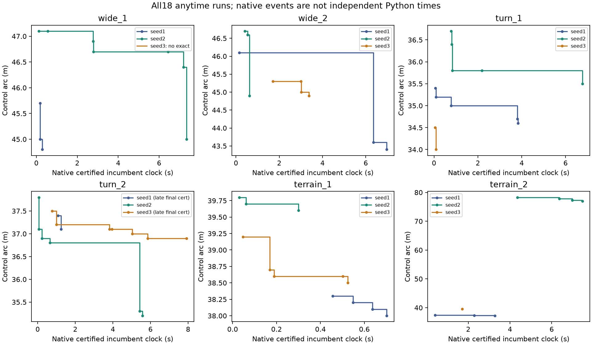

# 6D-S：54次障碍规划恢复与H1科研决策

## 最终判断：PIVOT

本阶段完成全部54次原预登记搜索，三次pilot原样复用，没有追加种子、改图或调参。实际plan已使用`auv_pitch_contract_v1`。模型、安全、实际规划入口和轨迹终审通过，**本阶段不开发H1**。

成熟SST首解在6/6开发图每图至少2/3严格原生成功，Anytime按冻结最终证书口径也达到5/6，满足原登记的反对“广泛成熟基线瓶颈”证据门槛。当前“需要净距—姿态条件化时长才能解决这类任务”的立项依据不足。该判断限于六张已见开发图，不推导独立泛化，也不证明任何潜在H1实现必然无效。

必须区别两个预算口径：**冻结最终回传认证链路M_final=47/54；10秒前至少已有一条独立认证保存候选的M_available=49/54。** 两条差异任务的首个incumbent已及时认证，但最终候选认证逾期。原主统计和失败标记完整保留，另公开54条可用候选账本，不能把这两次描述为搜索未找到可行解。

交付[PR #14](https://github.com/Whsjbwy/erqulunwengfx/pull/14)，目标`fix/auv-stage6dr-pitch-contract`，开放未合并。准确最终HEAD的Windows CI、artifact下载核验和最终状态在PR正文登记，避免回填文档再次改变被验HEAD。

## P0：来源、接线与冻结差异

准确基点为PR #13 HEAD `e02cc05dd288b329d0ab11e783bceb0300e1e5ad`。已核对6B/6C/6D/6D-R代码、协议、真实结果及6D-R最终Windows CI 43861363081，其artifact证明模型接口PASS。

6D-R入口刻意禁止plan；旧6C计划函数仍构造名义pitch bounds，因此本轮新增独立`native/stage6ds`入口。实际plan明确调用`auv6dr::information`，直接构造官方OMPL 2.0.2 Control RRT/SST；实际planner持有的SI指针、声明bounds、正负容差状态及实际参数均检查并输出，不能只靠ID字符串。身份反例测试把旧窄边界SI交给真实RRT，要求检查器拒绝。

复用冻结模型、连续区间oracle、Propagator、Goal、代价与路径证书。6C的计划编排和只读SST incumbent观察器作必要的最小版本化复用，未覆盖官方solve、选点、控制采样或剪枝；[计划函数逐项差异](../results/stage6ds/native_entry_diff.patch)公开。新增内容为修复SI接线、身份/输入守卫与元数据。原6D-R入口仍编译存在，实际plan请求退出1；官方源码和阶段1—6D-R原件均未修改。

| 项目 | 冻结设置 |
| --- | --- |
| 模型 | 五状态`(x,y,z,yaw,pitch)`简化运动学，固定速度作为参数 |
| 速度、角速率 | 1m/s；yaw率±10°/s、pitch率±5°/s |
| pitch、步长、目标 | 名义±20°及原1e−12rad数值容差；0.1s；0.75m位置球、终态姿态自由 |
| 有限尺寸安全 | `sqrt(1.04)+0.25m`球、曲线弦偏差界和完整连续扫掠 |
| 地图与种子 | 原6图；每图原生seed1/2/3 |
| 条件 | Control RRT首解、SST首解、SST Anytime |
| SST、采样与传播 | 选点2.0、剪枝0.1的复合状态尺度；goal bias0.05；1—50步 |
| 预算 | 原生8s；启动/回传/独立首次和最终证书10s；参考/LOS与复核20s；合计30s |

pitch声明范围只继承6D-R审核过的`±(L+t)`。没有clamp或额外放宽。复合度量含位置米与姿态弧度，2.0不能解释为空间2米。实际SI仍执行`bounds AND frozen_validate_state AND sphere_geometry`，传播逐0.1秒调用未修改的完整区间oracle。

本模型没有水动力、滚转、加减速、扰动或实物辨识，不能称为真实6DOF AUV动力学；本轮结果支持该明确简化模型下的结论。

## P1：搜索前验收与pilot

同一实际规划二进制先完成69个正负pitch/ULP/容差/近零/非法速度与控制/中途穿障/面棱角接触/工作空间边界案例，原13例共930接受区间，以及六图全部2440个给定控制区间。terrain_1完整370步通过。3次planner_check走实际plan函数的构造/配置路径并构造真实官方planner，在solve前返回，随机搜索数0。

实际区间尝试3398条，新SI与冻结Python位置最大差0，RK4选定区间抽查最大差`1.2079226507921703e−13m`。RK4为首/中/尾选定区间复核，所有区间另有完整独立解析积分与连续安全认证。非法源状态不违反官方传播接口前提强行调用，拒绝控制则从合法源状态实测0步。

旧probe继续在索引89测得expected1/actual0；新接口接受同源区间。5项CTest通过，含冻结模型、冻结度量、原始故障检测、6D-R边界和实际planner身份。前置539项pytest通过，编译、Ruff、格式和clang-format通过后才开始pilot。

pilot固定wide_1、seed1三条件：RRT为安全近似返回；SST首解与Anytime均严格原生和LOS成功。三次最终认证时刻约8.1414、0.3301、8.4729s，原生峰值约51.47、10.11、61.12MiB，记录均小于10MiB。审核依据为接口/证书/计时/资源，不以成功率挑选。原始记录只运行一次，随后完整复用进入54条账本。

## P2：全部54结果与准确分母

| 条件 | K | M_final | M_available | Gref/E | S | M_final/K | S/E | S/K |
| --- | ---: | ---: | ---: | ---: | ---: | ---: | ---: | ---: |
| Control RRT首解 | 18 | 15 | 15 | 15/15 | 11 | 83.33% | 73.33% | 61.11% |
| SST首解 | 18 | 17 | 17 | 17/17 | 11 | 94.44% | 64.71% | 61.11% |
| SST Anytime | 18 | 15 | 17 | 15/15 | 10 | 83.33% | 66.67% | 55.56% |
| 合计，仅作账本 | 54 | 47 | 49 | 47/47 | 32 | 87.04% | 68.09% | 59.26% |

M_final严格继承6D `run_one`的最终候选认证完成口径；E是该流程实际合格执行数。M_available是审计补充，检查**保存的first/final候选集合中**是否已有10秒内完成独立证书者；不重搜、不增加LOS、不更改原主结果。两条只及时认证first的任务没有为其另做LOS，不能补成E或S。

原生exact未经预算筛选有49次，近似5次，没有进程异常或no_solution返回。所有近似控制同样重积分和认证，不能计严格到达成功。逐图表中的M、S均为计数，每个格的登记分母为3：

| 地图 | RRT M_final，S | SST首解 M_final，S | SST Anytime M_final，S |
| --- | --- | --- | --- |
| wide_1 | 2，2 | 2，2 | 2，2 |
| wide_2 | 3，3 | 3，3 | 3，3 |
| turn_1 | 2，2 | 3，3 | 3，2 |
| turn_2 | 3，0 | 3，0 | 1，1 |
| terrain_1 | 3，3 | 3，2 | 3，1 |
| terrain_2 | 2，1 | 3，1 | 3，1 |

Anytime的turn_2按M_available为3/3，最终证书链路只有1/3。这一差异完全披露，不能用于削弱成熟基线以支持H1。

### 两条最终证书逾期的真实时钟

| turn_2 Anytime | 原生进程wall/s | 首次独立证书/s | 最终独立证书/s | 处理 |
| --- | ---: | ---: | ---: | --- |
| seed1 | 8.0260 | 8.9730 | 10.0786 | M_final失败，M_available成功；未追加LOS |
| seed3 | 8.0299 | 9.9225 | 11.3009 | M_final失败，M_available成功；未追加LOS |

代码先保存原始时钟，再做可能抛异常的验证。没有把事后重认证耗时当作原始耗时，也没有把原生incumbent事件时刻倒填成Python证书时刻。Anytime的首次Python证书在完整进程返回后完成，其时间是可用性上界，不能当作原生首次搜索发现延迟。8秒为原生墙钟终止检查，最终序列化及认证继续计入10秒；未声称进程在10秒强抢占终止。

### 失败与执行机制边界

冻结最终链路7次未计M：5个近似返回、2个最终认证逾期。47个实际LOS中15次严格失败：4次tracking_error_limit、9次goal_reached_required_margin_violated、2次physical_sweep_rejected_workspace_boundary。原生控制轨迹的安全认证均通过；到达与全程余量不是同一判据。不能将15次执行失败改算成原生搜索不安全。

turn_2的RRT和SST首解各3/3原生成功、0/3严格LOS，表明剩余困难集中在已选原生轨迹进入共同参考/冻结跟踪后的阶段。当前没有新的因果对照，不能唯一归因于终端触发、参考桥段、急转弯或某个控制参数。失败位置CSV保留首个记录到的限制候选区间；候选端点和近似轨迹终点均不冒充精确碰撞瞬时位置。

## 路径质量、时间和不确定性

最终合格子集的控制弧长中位数：RRT45.8m（n15）、SST首解39.2m（n17）、Anytime39.6m（n15）；合格子集不同，不能据此将Anytime排为劣于首解。固定同图同种子的15个双边最终合格配对中，Anytime14次至少改善0.1m、1次平台。采用补充截止可用集合的17对，则14次改善、3次平台，其中两次使用及时认证的first。全部原生事件曲线保留浮点平台，不冒充真实路径改善。

全部18任务最终证书完成时刻中位数分别1.0756、0.8059、8.5718s，含近似及逾期返回。Anytime持续优化与首解停止机会不同，图中原生事件时钟、最终独立证书和条件路径成本分别呈现，不作未经控制的综合强弱排名。

CSV局部净距保留原3m查询截断，返回路径姿态特征和传播拒绝计数只是描述数据；没有逐次扩展的因果对照可据此认定净距—姿态时长是失败主因。

仅6个开发地图聚类、每图3固定种子。逐图完整计数和剔除任一地图的M_final/K敏感性范围分别为RRT80.00%—86.67%、SST首解93.33%—100%、Anytime80.00%—93.33%。这是确定性的样本敏感性，不是置信区间或显著性检验；没有独立测试地图或论文确认性证据。固定种子不保证墙钟截断下跨机器逐位返回相同轨迹。

Late表示最终独立认证逾期，两个Late均已有及时的首次证书，见可用候选CSV。

曲线含全部18次，未找到exact者在图例标记；late final cert曲线保留原生已认证成本，不能直接计作M_final。

## 终审、工程与资源

只读终审复查54任务24,313个返回区间、额外首次incumbent6,832个区间和21,283个LOS区间，重算冻结目标、运动学、引导/内环指令、状态、时钟和完整连续安全。独立RK4最大位置差`3.574849180676073e−14m`，LOS位置复算差0，没有严格安全成功假阳性。终审不修改原始性能时钟，不生成新的完整轨迹副本。

最终本机**545项pytest通过，0失败/错误/跳过，13.38秒**；compileall、Ruff、格式、clang-format均通过，5/5实际CTest通过。原6D-R plan守卫实际退出1。真实命令/日志、JUnit及分别记录的身份/模型门槛见[命令与质量记录](STAGE6DS_COMMANDS_CN.md)。本机质量元数据如实标为工作树检查，最终PR HEAD另由Windows CI从官方源码重新构建并执行确定性验收，CI不重复54随机搜索。

第一次CMake配置因父目录看不到子目录导入的`ompl::ompl`而失败，未执行搜索；只在新增6DS父构建目录声明依赖后成功。原非零配置日志和全部后续命令保留。开发中的格式长行、导入顺序及空值统计检查均在报告代码中修正，没有改实验输入或原始记录。

54个原始任务目录，约9.16MB；原生最大峰值63.27MiB，单任务最大377,839字节。可用RAM≥4GiB阈值分支实际检查，未逐次保存可用RAM数值，不能事后补造；真实RSS逐次保存。串行、CPU原生运行，最多2个编译worker，未使用GPU或安装系统工具。依赖和旧网格单份引用，无额外文件hash清单。临时盘符经核对后撤销，最终证据见PR。

## 科研解释与唯一下一步

成熟SST的原生覆盖及Anytime成本改善直接削弱本轮H1广泛必要性主张；9次余量、4次误差和2次边界执行失败同时说明统一参考/控制执行仍有能力边界。没有新机制对照可以把这些失败唯一归因到时长采样。文献复核仍不能证明H1原创性或数学等价性，见[近邻证据边界](STAGE6DS_LITERATURE_CN.md)。

选择**PIVOT当前H1方向**，不批准其原型开发。唯一建议的后续动作：**另行提交“原生安全控制轨迹到统一跟踪参考的安全契约”研究问题立项审查**，先界定新问题和已有方法。该建议不授权继续调参、追加地图或实现新算法。本阶段到此停止，等待研究者与ChatGPT审核。
