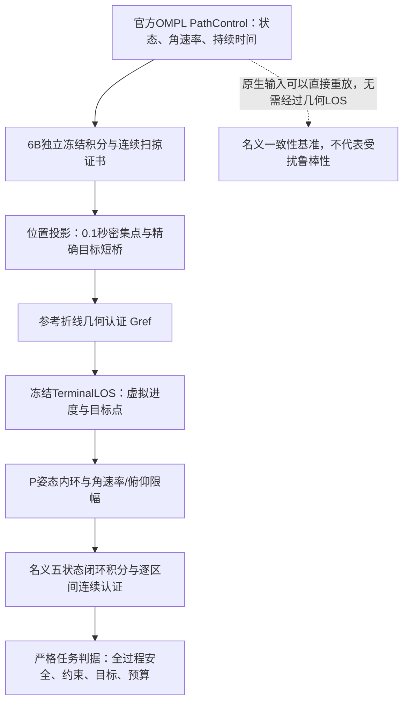

# 7A接口契约：原生控制—几何参考—跟踪执行

## 1. 四层及真实入口

| 层 | 冻结代码 | 输入/输出与可证明范围 |
|---|---|---|
| 实际规划入口 | `native/stage6ds/`，复用 `native/stage6dr/` 版本化pitch契约 | 官方Control RRT/SST输出PathControl；不修改OMPL源码 |
| 原生独立积分与认证 | `src/gsunlight_repro/stage6b/replay.py` 的 `_replay`、`audit_controls` | 按保存控制时长积分，与OMPL节点比较；连续曲线扫掠，不是仅查端点 |
| 参考转换 | 同文件 `track_reference` | 取初始点+独立积分0.1秒位置点，必要时接精确目标短桥；几何折线证书 |
| 有限路径终端引导 | `stage5af/guidance.py` 的 `TerminalLOS` | 包装 `stage5ae/guidance.py` 的 `LOS`，在终端窗口锁定目标；输出方向目标点和进度元数据 |
| 控制与积分 | `stage5ar/replay.py:control`、`stage5a/tracking.py:integrate`，由 `stage5af/tracking.py:simulate` 调用 | P姿态误差生成角速率、限幅并预测下一步pitch；名义积分 |
| 严格任务评测 | `stage5af/tracking.py`、`stage6ds/` 结果台账 | 分开物理、任务边界、必需余量；不能只用目标到达或小路径误差判成功 |
| 7A只读审计 | `stage7a/audit.py` | 只读旧输入、输出和数组；没有调用上面任何传播/规划/跟踪入口 |

所有路径均相对仓库；以PR #14的冻结基线阅读，而不是修改这些模块。7A只补充独立审计模块。

## 2. 冻结模型不是6DOF水动力学

状态 `q=(x,y,z,ψ,θ)`，控制 `u=(r,q_p)=(ψ̇,θ̇)`：

\[
\dot x=v\cos\theta\cos\psi,\quad
\dot y=v\cos\theta\sin\psi,\quad
\dot z=v\sin\theta,\quad
\dot\psi=r,\quad\dot\theta=q_p.
\]

v=1m/s固定；|r|≤10°/s，|q_p|≤5°/s，|θ|≤20°，步长0.1s。保存接口数组第6个量为固定速度，不能据此称为六状态动力学。z向上，与MSS/部分AUV文献的NED向下约定不同；Euler角速率也不能在俯仰非零时无说明地等同体坐标角速率。模型无质量、惯性、推力、roll、sway、heave动态、执行器滞后或流场。

连续安全要求外接球半径 `r_b=sqrt(1.04)≈1.0198039m`，再加0.25m必需余量。控制区间的弦线使用曲线偏离上界膨胀认证；碰撞/任务边界均包含在证书内。pitch边界使用6D-R版本化数值契约，数值容差不是新增物理余量。目标是位置距scene.goal≤0.75m，终端姿态自由；不能通过精确朝向目标点要求偷换目标集合。

## 3. 丢失信息、终点与分段

原生轨迹包含分段常值角速率、持续时间、节点姿态及完整初态。几何接口保留位置折线，传入LOS时不再传入原生时钟、ψ/θ序列、原生角速率或原生控制段持续时间。完整初始姿态仍由执行器接收：47条保存记录均已核对，**不是**默认把初态朝向目标。

当前LOS的路径变量是虚拟进度s，而不是原生时间t；相同t的状态偏差、到整条折线的最近点距离、到虚拟参考点的距离是三种量，7A分别记录，禁止互换。进度由切向投影和沿程误差反馈更新，不是每步重置到全局最近点。

TerminalLOS的触发进度是 `max(最后非零段起点,L−2m)`。原生终点已在0.75m目标球内，精确目标桥段长度≤0.75m，通常最后一段就是短桥，因此“2米窗口”不等于进入距目标2米就触发。新审计中的 `guide_bridge_entry` 是虚拟进度达到原生位置弦长总和，**不表示实际车辆已到桥段**。触发信息在区间起点评估而保存于该区间的候选记录；报告统一用候选区间结束时间，原始摘要的开关起点时刻可能相差0.1s。

需要独立区分：①追加桥段改变几何；②同一几何重新分段会改变最后一段/切换语义；③终点触发规则。简单删桥既改变路径终点，也违反当前参考必须结束于scene.goal的前置约定，不能称为只改变几何的一因素消融。桥段几何安全不等于具有同一姿态、固定速度和曲率约束下的控制延拓；现有代码也没有宣称它是原生控制延拓。

LOS先计算期望方向，再经P姿态内环生成受限角速率。没有原生角速率前馈，不能把它称为原生控制闭环重放。固定正速度且受限曲率的系统无法悬停在终点，须以有限目标球首次进入判据设计时域末端，不能假设无限时域固定点稳定。

## 4. 安全与完成契约

每步先得到候选状态，计算物理、任务、必需余量判据并保存记录；必需余量失守累积在`clearance_ok`，**不会立即终止旧模拟**。旧循环在物理拒绝、任务拒绝或全局路径误差>3m时停机，或在下一轮检测到目标球到达。故最终 `goal_reached_required_margin_violated` 可能隐藏更早失守，`tracking_error_limit`也不必是首次严格失败。

7A不改变旧逻辑或失败标签，而新增首次余量/物理/任务/跟踪、目标球进入、终端切换和引导桥段事件。`not_recorded`表示字段未保存，`not_observed`表示完整已保存字段中未观察到事件，两者不能当作0。

当前证据没有认证跟踪误差管。若空间误差与同一时刻名义点的偏差有可靠上界ε(t)，且名义中心的障碍距离≥r_b+0.25+ε(t)，可推出球包络安全；若只知道最近折线距离，则还须确保对应整条参考的局部安全界适用。已实现轨迹的最大误差、带3m查询截断的净距下界或某一活跃参考段的原生净距，都不是全状态可达管证书。

## 5. 数据字段解释

`execution_index.csv`每条保留来源路径、原标签、节点/控制段数、两类时钟与初态检查。`failure_audit.csv`是其15条失败子集；`event_audit.csv`使用原始零起始数组索引定位事件。

`native_minimum_required_gap_m`来自旧独立原生证书；`LOS_minimum_body_mission_gap_m`来自旧执行摘要的外接球/任务边界净距；减0.25得到`LOS_required_gap_lower_bound_derived_m`，是派生下界。首次事件的`native_gap_on_first_failure_active_segment_m`仅关联当时虚拟参考活跃的原生密集段；不是实际车辆附近障碍的独立局部最小距离，活跃段是桥段则记未知。高俯仰/饱和统计来自保存状态、指令或方向目标，不添加新控制计算。

原始数据没有扰动历史、实物执行或认证误差管，均保留`not_recorded`。所有7A数据属于历史名义模型模拟的只读再统计。
