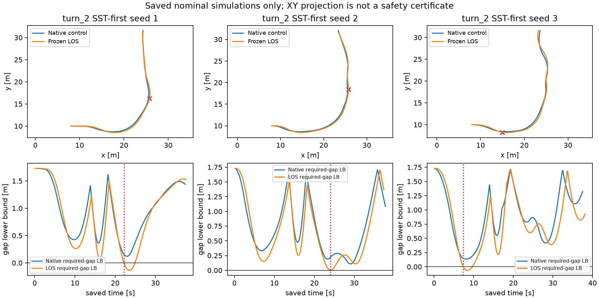
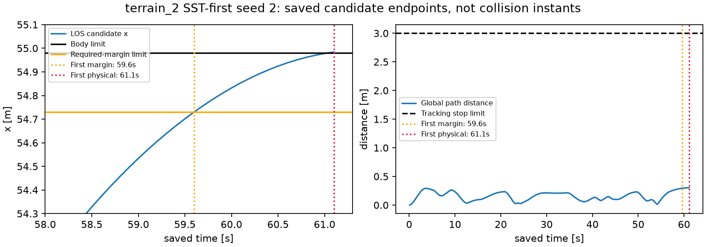

# 第七阶段7A：安全参考契约研究立项与强基线审查

审查日期：2026-11-16—2026-11-17。科研决定：**PIVOT**。停止把“从OMPL控制轨迹改为几何LOS后失败”直接包装为原创规划问题；T1/T2目前均缺少可辩护的实质差异。不批准H1或新的原创模块。本报告没有声称成熟控制器已经在这47条记录上恢复成功，因为本阶段没有实施该控制器或新回放。

## 1. 审查对象与工作边界

基线为开放、未合并的[PR #14](https://github.com/Whsjbwy/erqulunwengfx/pull/14)，最终HEAD `43660a5008983ee9bf20a670eaed18463d748e22`。新分支 `research/auv-safe-reference-stage7a`，目标 `research/auv-obstacle-baselines-stage6ds`。历史源码、CSV、轨迹、54条计划及BLOCKED证据均不改写。

已阅读任务书及6B—6D-S的规划适配、冻结模型、pitch数值契约、独立认证、参考转换、TerminalLOS、最终轨迹审计和质量记录。重点代码及契约见[接口分析](STAGE7A_INTERFACE_CONTRACT_CN.md)。实际逐条打开47组原始 `input.json`、`output.json`、`independent_record.json.gz`，来源在工作区 `local_only/stage6ds_runs/search/<job_id>/`。所有源文件齐全，未从摘要补造轨迹。本阶段不重新积分、规划或控制回放，不建地图、不调参、不实现控制器。

新增审计只比较已保存数组、节点和几何统计。每条核对官方PathControl的控制段数/时长、0.1秒样本数、已保存角速率、节点位置/角度/速度、输入完整初态以及实际LOS初态；47条均通过对应检查。它依赖6D-S已经保存的独立积分和连续认证证书，**不是7A再次执行认证或实物验证**。

## 2. 保留全部分母

| 方法 | 登记K | 最终原生可行M_final | 截止前候选M_available | 几何参考通过Gref | 实际LOS E | 严格成功S |
|---|---:|---:|---:|---:|---:|---:|
| Control RRT首解 | 18 | 15 | 15 | 15 | 15 | 11 |
| SST首解 | 18 | 17 | 17 | 17 | 17 | 11 |
| SST Anytime | 18 | 15 | 17 | 15 | 15 | 10 |
| 总计 | 54 | 47 | 49 | 47 | 47 | 32 |

来源：冻结 `results/stage6ds/planning_runs.csv`、`rates.csv`、`deadline_available_incumbents.csv`，本阶段建立 `results/stage7a/execution_index.csv` 的47条索引。原生可行率47/54=87.04%，条件LOS严格成功率32/47=68.09%，登记任务整体成功率32/54=59.26%。Gref/M_final=47/47仅说明参考折线的几何认证通过。49/54是另一候选可用性口径，两个逾期final没有旧LOS记录，不能替换47或生成新结果。

六图都是开发图，种子只有1/2/3；方法和种子嵌套于地图，不能把47当作独立留出样本。完整失败分母仍为15；直接比较保存的完整LOS逐步记录发现其中两对完全相同，因此有13条不同完整失败轨迹。相同轨迹不意味着其他13条彼此统计独立，也不意味着有13种因果机制。

## 3. 首次严格失守与最终停机不同

| 口径 | 计数 | 解释 |
|---|---:|---|
| 原终止：tracking_error_limit | 4 | 保留旧标签，不改历史 |
| 原终止：到达目标但必需余量失守 | 9 | 较早累计安全失败，到达时最终归类 |
| 原终止：物理工作空间扫掠拒绝 | 2 | 终止发生在物理外接球边界 |
| 7A最早严格事件：必需余量失守 | 12 | 含1条后来tracking终止和2条后来物理终止 |
| 7A最早严格事件：跟踪误差>3m | 3 | 到首次事件之前未记录到更早安全失守 |

时间为保存候选控制区间的结束时间，不能称为精确碰撞时刻；位置为候选状态，连续认证可能在区间内部拒绝。`event_audit.csv`给出区间起止、候选坐标、零起始索引和原数组指针。

15条中11条首次严格失败发生在虚拟引导进度进入终点桥段之前；仅4条首次事件时处于终端模式。这排除了“所有首次失败都由进入桥段之后的终端引导引起”的解释。没有做反事实回放，不能由此推断桥段对所有路径完全无影响，或为具体控制项分配因果比例。

### turn_2：三条SST首解

| 种子 | 首次必需余量失守/s | 最大全局路径距离/m | 原生最小必需净距下界/m | LOS最小必需净距下界/m | yaw/pitch饱和步数 | 首次事件时终端模式 |
|---|---:|---:|---:|---:|---:|---|
| 1 | 22.2 | 0.298619 | 0.123090 | -0.135408 | 0 / 6 | 否 |
| 2 | 24.0 | 0.284287 | 0.109606 | -0.000330 | 12 / 43 | 否 |
| 3 | 7.4 | 0.444611 | 0.135562 | -0.063229 | 117 / 2 | 否 |

三条均原生可行、最终进入目标球，但LOS均失去0.25m必需余量。第1条没有yaw饱和仍失败，不能把饱和解释为必要条件。第2条下界负值很小，必须按冻结连续证书判失败，不能舍入为零或放宽阈值。全局路径误差远低于3m仍可安全失败，说明这个停机误差阈值不是局部安全保证。当前只证实相同初态下两个控制策略的执行分离及余量失守，没有证实需要更改规划算法。

上图只画保存轨迹的XY投影和逐区间净距下界；二维线条重合程度不作为三维安全证书。原生与LOS按同一时钟展示，几何距离与时序误差分别登记。

### 两条工作空间拒绝

`terrain_2--sst_radius2_first--seed2` 与对应Anytime记录的**完整LOS逐步数组相同**，原生密集数组并不相同，不额外算独立机制。两者59.6s首先必需余量失守；61.1s才因物理工作空间拒绝终止。首次失守候选为 `(54.730489,34.646195,12.487608)`，最终拒绝候选为 `(54.984037,33.171892,12.454809)`，全程最大全局路径误差约0.303238m，尚未进入桥段/终端模式。

该图x上界56m，外接球半径 `sqrt(1.04)`，故物理中心上限约54.980196m，含余量上限约54.730196m。现象与已保存区间认证一致；边界线图只解释量级，不替代扫掠判据。

## 4. 已证实、可推导、尚未验证

**已证实：** 原生控制与LOS控制不是相同策略，完整初态一致；Gref通过不保证LOS安全；12条首先安全失守；11条首先失败在引导进度到桥段之前；3m路径距离门槛未与局部安全余量绑定；当前损失参考的时间/姿态/控制前馈信息有真实代码依据。

**数学推导：** 相同名义初态、相同确定性模型、完全相同输入序列会产生相同轨迹；因此保留原生控制是必要的一致性对照。该推导不提供扰动鲁棒性，也不产生一个新的“47/47闭环实测成功率”。若能独立证明全部时刻位置偏差管半径为ε，且名义中心轨迹到障碍/边界的距离至少为外接球半径+0.25m+ε，则安全可由距离的Lipschitz性质推出。**记录中的最大误差不是未来误差管证明**，全局最近路径点也未必等于同时刻参考点。

**尚未验证：** 原生控制/姿态/时间丢失分别占多少因果作用；成熟前馈反馈能恢复多少失败；高俯仰、转弯、局部低余量分别的独立效应；扰动下的安全管、实际AUV动力学和实物执行。字段缺失保持`not_recorded`，不会用0替代。

## 5. 文献与方向

实际核验13项文献，其中11项为2023—2026年、2项为基础文献；10项取得可读全文并重点阅读方法，另3项明确标注元数据/代码或索引方法片段范围。[矩阵](STAGE7A_LITERATURE_CN.md)逐篇给出DOI、链接、实际全文范围、代码和许可。当前无任何外部控制软件构建/运行成功声明。

时间状态/输入前馈与反馈跟踪已有成熟定义；ALOS官方代码也提供角度/角速度参考观测器。跟踪误差界、漏斗、障碍膨胀及安全参考调节已有[FaSTrack](https://arxiv.org/html/2102.07039v2)、[Funnel Libraries](https://arxiv.org/html/1601.04037v3)、[PBF](https://existentialrobotics.org/ref/Li_GCBF_Automatica23.pdf)等明确最近邻。由这些证据作出的判断是：当前T1主要是恢复必要参考信息的工程校准；T2泛泛的“余量感知协同”不足构成立项创新。未检索到代码或未取得某文全文都不代表新颖性已经成立。

最有意义的未来强对照是同一五状态模型上的**名义输入前馈+有限时域LTV-LQR反馈**，而不是仅继续与几何LOS比较。它尚未实现，限幅与恒速系统的局部可控性限制必须独立验收。无必须几何接口的硬件证据时，OMPL输出无需强制改为LOS。不能以人为丢弃可用信息造成失败，再据此论证新规划器必要性。

## 6. 工程证据与交付

新提取器、图表模块及测试只在stage7a新增路径。原6D-S最终Windows CI为[43880699051](https://github.com/Whsjbwy/erqulunwengfx/actions/runs/43880699051)：545项pytest、5项CTest及69+13+六图2440区间实际规划入口确定性验收。历史 `final_trace_audit.json` 的24313原生区间、6832额外首候选区间、21283 LOS区间、零严格安全假阳性属于6D-S证据，7A没有重跑这些积分。

7A实际命令、完整Python检查和最终HEAD Windows CI取证方法见[检查记录](STAGE7A_CHECKS_CN.md)。本阶段不改C++，不重建OMPL或重跑CTest；不得把历史CTest写成新执行。新CI只做Python工程检查和公开数据一致性检查，无私有轨迹依赖，无新实验。最终HEAD的运行身份由CI产物中的`head`与PR HEAD比对，避免把前一提交CI当成最终证据。

本报告完成后停止。7B仅有[预注册草案](STAGE7B_DRAFT_PROTOCOL_CN.md)，其预算、地图和对照均未执行，也不构成下一阶段授权。
