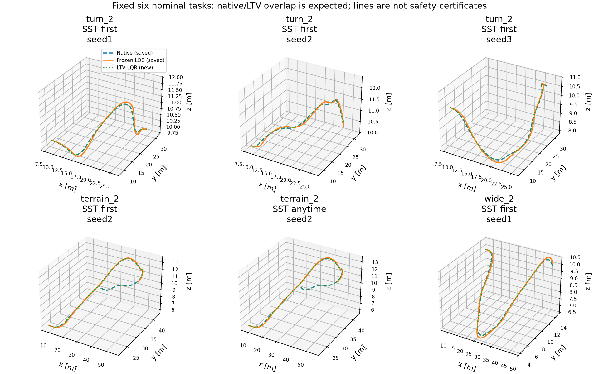
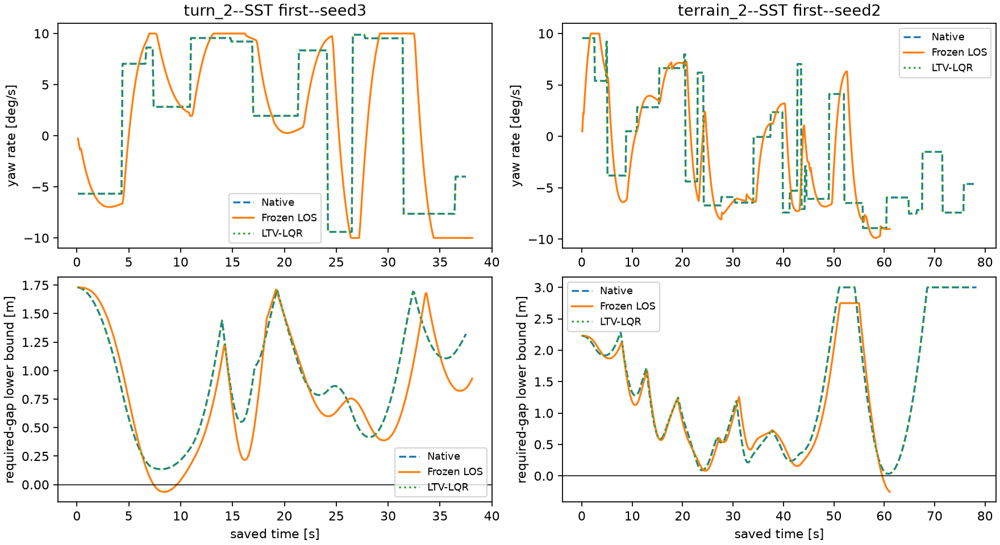

# 第七阶段7B-0：成熟跟踪基线有限验证

日期：2026-11-17。结论：**ENGINEERING-RESOLVED，限于本轮固定六任务。** 原生时序、完整姿态和输入可直接保留，无实际接口证据要求强制转换为几何LOS。标准名义输入前馈加有限时域LTV-LQR在六次新增无扰动、零初差执行中6/6严格成功；冻结LOS历史结果为1/6，恢复5条旧失败，无退化。到此停止，不恢复H1，不批准T1/T2原创立项，不追加扰动或新规划。

## 1. 起点、数据与范围

基线[PR #15](https://github.com/Whsjbwy/erqulunwengfx/pull/15)经在线核实仍为 `24cc32d1cb2df0ba1fc50b08345840e7d3c6c0e8`，开放未合并。工作分支 `research/auv-stage7b0-mature-tracking-check`，目标为7A分支。任务书和7A报告、接口契约、假设决定及7B草案已审查；本阶段只批准草案第一关，不批准其中扰动、独立图或消融执行。

固定六任务使用7A预登记名单，完整原始input/output/证书/轨迹齐全。旧源只读：`local_only/stage6ds_runs/search/<job_id>/`，地图直接读取旧输入引用的.u8字节，复用相同原点、尺寸、分辨率、占据与任务顶界；不调用地图生成器，也不运行官方规划入口。新六轨迹唯一完整副本位于仓库外 `local_only/stage7b0_runs/<job_id>/execution.json.gz`，总计316748字节。公开数据只有摘要和CSV，不重复拷贝原生大轨迹。

B0首先调用7A只读来源对应检查，核对官方输出节点/控制与保存的密集状态、控制段时长、完整初态及旧原生证书。不存在“只允许几何LOS”的硬件或软件约束证据，保留原生信息是标准路径；不为研究动机人为删去控制前馈。

## 2. 冻结模型和公平口径

五状态 `(x,y,z,ψ,θ)`，`p_dot=v*(cosθcosψ,cosθsinψ,sinθ)`，`ψ_dot=r`、`θ_dot=q`；v=1m/s固定，r限±10°/s，q限±5°/s，pitch名义±20°及继承数值容差1e-12rad。步长0.1s，z向上，机体外接球半径 `sqrt(1.04)`，必需余量0.25m，目标为位置球半径0.75m，终端姿态自由。速度是保存数组第六项固定参数，不是第六个动态状态；本模型没有6DOF、水动力、洋流、真实执行器滞后或实物标定。

NATIVE-OPEN使用保存的原生控制独立重放证书，六条均原生可行；它是名义一致性上限，不是反馈优势。LOS-FROZEN复用6D-S/7A真实保存执行、时间和失败标签。本轮仅LTV-LQR新增6次执行；每条再对实际新控制独立认证，不转移旧原生证书。三者目标、允许控制、植物和安全要求不变。

LTV-LQR在首次进入目标球时停止，或在原生时域耗尽、严格安全失守/限幅判据失败时停止；不使用精确目标桥段，不凭空补充控制。旧原生证书可能认证到控制段结尾才入球，保存的密集样本可能更早已进入球，因此新执行可以使用其安全前缀。这个停止规则与冻结LOS的目标球判据一致，不是新到达阈值。

## 3. 标准控制器与验收

实现与解析见[数学及实现说明](STAGE7B0_MODEL_CN.md)。以冻结精确常值角速率流F求解析A/B，沿名义状态/输入做反向离散Riccati，使用线性方程求解，不显式求逆。控制是 `u=u_ref−K*e` 后施加原限幅；yaw误差取wrap，不把速度当可优化控制。不加误差死区或人为置零，不根据成功率修改Q/R。

冻结权重：位置尺度各0.75m，yaw尺度为原10°一秒转角，pitch尺度20°；输入尺度10°/s与5°/s。故Q对角约 `(1.777778,1.777778,1.777778,32.828064,8.207016)`，R对角 `(32.828064,131.312254)`，Qf=Q。配置与运行源码在实验前提交 `a11a9b792b9f9bc063041060c8ba32a61dd90d01`，B1通过后不再调整控制实现或参数。

19项确定性验收全部通过，包括：8组解析A/B与冻结F中央差分（绝对容差2e-9，含零/微小角速率、联合转弯、±π与±pitch边界的局部导数）、独立标量Riccati最小代价正例、零误差前馈逐步相等、非零姿态误差的反馈修正、直线局部可控秩4与纵向反馈无权威、正负pitch数值包络/明显越界、非法控制与错误速度、自由端点但中间穿障反例、目标球/原生时域耗尽、篡改实际输入导致认证失败、初始已在目标但不安全仍拒绝。合成验收不是额外历史任务执行。

首轮3项雅可比测试失败源于测试的整数控制数组截断有限差分扰动；显式dtype=float修复后通过，未放宽2e-9容差。失败JUnit、修复后JUnit与最终19项逐例CSV均保留，没有隐藏失败。标准方法不命名为新算法，也没有声称复现Drake软件。

## 4. 六条实际结果

| 固定任务 | 旧LOS严格结果 | 新LTV-LQR | 已执行/保存原生区间 | 终点误差/m | 新最小必需净距下界/m | 本次执行及认证墙钟/s |
|---|---|---|---:|---:|---:|---:|
| turn_2 SST首解 seed1 | 余量失守 | 成功 | 371/374 | 0.707291 | 0.123090 | 2.126821 |
| turn_2 SST首解 seed2 | 余量失守 | 成功 | 369/378 | 0.744106 | 0.109606 | 2.068334 |
| turn_2 SST首解 seed3 | 余量失守 | 成功 | 372/375 | 0.690940 | 0.135562 | 2.090539 |
| terrain_2 SST首解 seed2 | 工作空间拒绝 | 成功 | 770/783 | 0.661315 | 0.033742 | 1.781973 |
| terrain_2 SST Anytime seed2 | 工作空间拒绝 | 成功 | 770/770 | 0.670335 | 0.033742 | 1.751467 |
| wide_2 SST首解 seed1 | 成功 | 成功 | 461/461 | 0.732697 | 1.752619 | 0.454611 |

以上数字来自真实运行 `execution_results.json`，完整六行对照见 `results/stage7b0/comparison.csv`，三方法18行见 `baselines.csv`。最小净距已经减去外接球和0.25m余量；距离查询上限3m意味着它是保守下界，不能把远处的3m值解释为精确障碍距离。

分母：登记K=6、可用原生M=6、新实际LTV执行E=6、严格S=6；无失败/超时/异常/未运行。继承原生6/6，继承LOS1/6，新LTV6/6；恢复旧失败5/5、保持成功1/1、退化0/1。固定诊断样本不是独立泛化集。两条terrain_2旧完整LOS相同，旧唯一轨迹口径为1/5成功；并不据此把新的六条轨迹也视为全部独立。

原6D-S的M_final47/54、M_available49/54、LOS32/47和全部历史失败保持不变。不能以本轮六样本结果推算新方法已在15条失败、47条原生路径或54项计划上全部执行。

## 5. 连续认证、时钟及安全假阳性

在线每个区间采用冻结的物理/任务/必需余量三个球扫掠oracle，并以 `v*hypot(r,q)*h²/8` 膨胀弦线覆盖真实曲线偏离。全部3113个新控制区间另从原完整初态交给冻结6B独立重放，比较每个状态和安全判据；再以50子步RK4逐区间交叉检查。最大状态位置/角度对应差均0，最大RK4位置差 `5.695433295429594e-14m`，新在线严格成功声明中安全假阳性0/6。独立证书记录在每个新 `result.json` 与公开摘要中，完整再积分数组只在内存中比较，不再存第二份轨迹。

所有新执行的首次余量/物理/任务失守均为未观察到。旧LOS首次严格事件与最终停机仍分开：turn_2三条首先余量失守，terrain_2两条59.6s余量失守、61.1s物理边界拒绝；不能只看终止标签。

原20秒执行认证预算不变，新墙钟包含增益构造、实际执行、原始新轨迹保存、冻结独立重放及逐区间RK4。原最终规划认证实测时间与本轮执行认证相加均在原30秒预算内。CSV的`combined_wall_s`是**旧规划测量+新执行测量的预算核算值**，并非本轮重测规划端到端时延。没有新搜索或增加原规划预算。历史NATIVE/LOS的旧墙钟不与本轮LQR墙钟作算法速度优劣统计。

## 6. 轨迹与控制对照

新轨迹与原生轨迹重合、输入与原生输入差为0是预期现象。图中线条/投影不替代三维连续安全证书。新轨迹提前入目标球后的原生控制尾部不继续执行，旧LOS失败和其全部保存点仍完整保留。

## 7. 科研判断及下一步

六条无扰动零初差结果的主要含义是：保存运动可行控制信息的标准接口可以消解本轮几何LOS失败；没有必要据此再创新规划器或持续修复LOS。六例反馈项始终为0，所以结果不能证明LQR反馈抗扰性能，非零误差功能只经过合成正确性测试。恢复成功不是原创成果、鲁棒性证明或真实海试。

候选方向分析为[固定两页PDF](../results/stage7b0/output/pdf/stage7b0_directions_cn.pdf)及[同源文本](STAGE7B0_DIRECTIONS_CN.md)，仅保留“有限感知流场上界与受限转向下的持续安全/可行性判断”一个待查新假设。2026年流场走廊规划与局部不变集工作已经存在；最近邻全文与等价性尚需补证，不批准算法开发。本阶段未实现洋流、MPC、6DOF、强化学习、网络或新RRT。

## 8. 质量与停止

实际命令、验收错误留痕、全量pytest/Ruff/编译检查和最终HEAD Windows CI证据见[检查记录](STAGE7B0_CHECKS_CN.md)。没有C++改动，不新增OMPL构建或CTest，也不把旧CTest当作本轮执行。CI仅执行合成回归和公开六行证据一致性检查，不重跑本地六次科研执行，不依赖私有原始地图/轨迹。

全部新文件相对7A基线为新增；新原始记录在独立本地目录独占写入，不重试、不覆盖。完成后停止，等待研究者与ChatGPT审核。
